<!-- ═══════════════════════════════════════════════════════════════════════
     CLIMO — Know the sky, Own the day.
     ═══════════════════════════════════════════════════════════════════════ -->

<p align="center">
  <a href="https://chakrabortysohini2005-stack.github.io/Web-Mobile-Application-CLIMO/">
    
  </a>
</p>

<p align="center">
  <a href="https://chakrabortysohini2005-stack.github.io/Web-Mobile-Application-CLIMO/"></a>
  <a href="https://github.com/chakrabortysohini2005-stack/Web-Mobile-Application-CLIMO/actions/workflows/android.yml"></a>
  <a href="docs/GALLERY.md"></a>
</p>

<p align="center">
  
  
  
  
  
  
  
  
</p>

<p align="center">
  <b><a href="https://chakrabortysohini2005-stack.github.io/Web-Mobile-Application-CLIMO/">Live demo</a></b> ·
  <a href="#-gallery">Gallery</a> ·
  <a href="#-features">Features</a> ·
  <a href="#-how-it-works">How it works</a> ·
  <a href="#-the-risk-model">Risk model</a> ·
  <a href="#-quick-start">Quick start</a> ·
  <a href="#-documentation">Docs</a>
</p>

---

<table>
<tr>
<td width="58%" valign="top">

### 🌏 What is CLIMO?

**CLIMO** is a weather and risk GIS for India. It runs entirely in the browser and also ships as an Android app.

It pulls **live readings for 90 weather stations across 33 states and union territories** and scores each one with a **flood-risk index**. It can show the result in several ways:

- 🔥 heatmaps and state-level choropleths
- 🎯 buffer zones
- 🧭 a **weather-safe route** that drives around risky areas
- 🕰 a **climate time machine** covering 2000–2030 (observed years plus an LSTM forecast)
- 💬 an offline-friendly assistant that answers plain questions like *"will it rain in Kolkata tomorrow?"*

The whole interface is translated into **16 Indian languages**.

> **No backend. No build step. No API key needed** for the core experience.
> Open one HTML file and the sky over India loads in seconds.

</td>
<td width="42%" valign="top">

### 📊 At a glance

| | |
|---:|:---|
| **90** | stations with live readings |
| **33** | states & union territories covered |
| **16** | Indian languages, switchable live |
| **2,790** | station-year climate records |
| **31** | years in the time machine (2000 → 2030) |
| **5** | live map layers + 2 base maps |
| **0** | servers, databases, or build tools |

</td>
</tr>
</table>

<p align="center">
  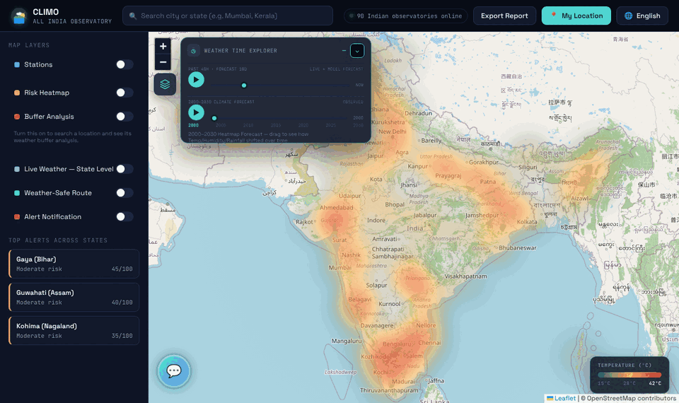
  <br>
  <sub><b>The climate time machine.</b> Drag the year slider from 2000 to 2030 and the station temperature field updates across the subcontinent. Years up to 2025 are observed; 2026 onward is an LSTM forecast.</sub>
</p>

---

## 🖼 Gallery

> Every image below is a **real, unedited screenshot** of the app running on live Open-Meteo data. The full-size set with captions is in **[docs/GALLERY.md](docs/GALLERY.md)**, and there is an interactive lightbox at **[docs/gallery.html](https://chakrabortysohini2005-stack.github.io/Web-Mobile-Application-CLIMO/docs/gallery.html)**.

<table>
  <tr>
    <td width="50%"><a href="docs/assets/gallery/02-landing-hero.jpg">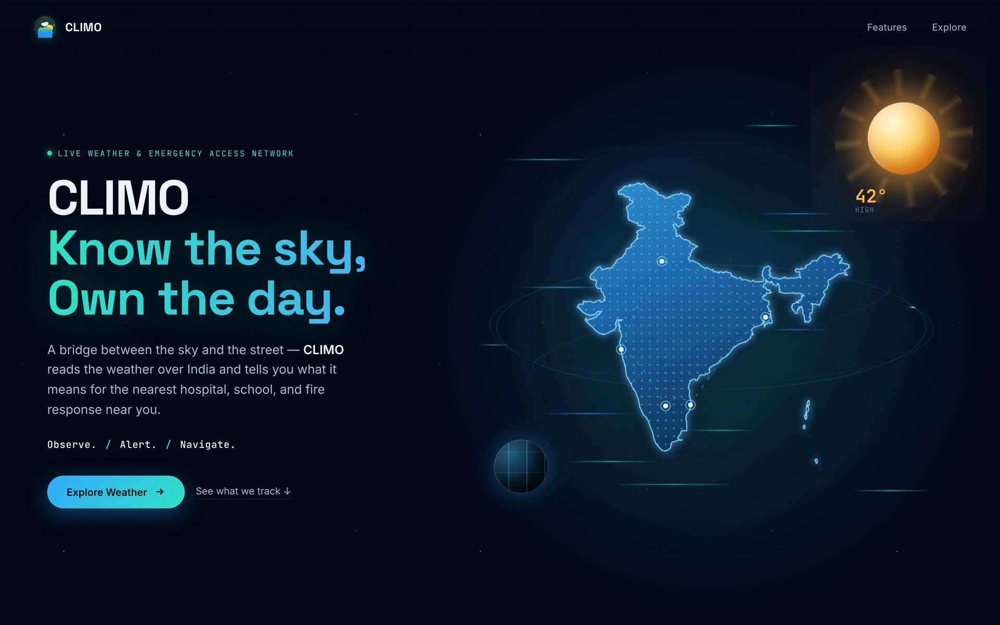</a><br><sub><b>① Landing</b> — 3D parallax India with live data-flow lines and a glowing sun.</sub></td>
    <td width="50%"><a href="docs/assets/gallery/04-dashboard-stations.jpg">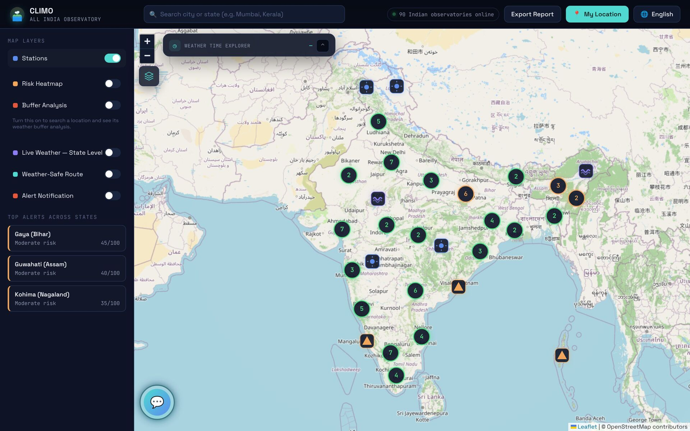</a><br><sub><b>② Observatory</b> — 90 clustered stations, with live top alerts in the sidebar.</sub></td>
  </tr>
  <tr>
    <td><a href="docs/assets/gallery/05-station-drawer.jpg">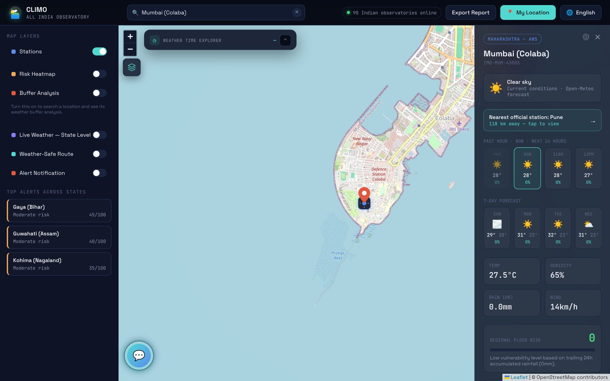</a><br><sub><b>③ Station drawer</b> — hourly strip, 7-day forecast, live readings and flood-risk score.</sub></td>
    <td><a href="docs/assets/gallery/07-state-choropleth.jpg">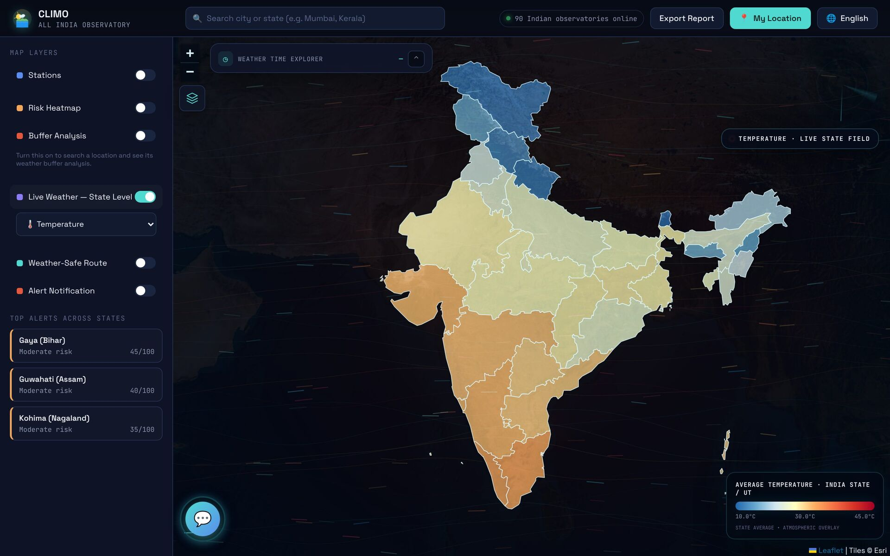</a><br><sub><b>④ State choropleth</b> — live state averages over a masked basemap with wind-particle effects.</sub></td>
  </tr>
  <tr>
    <td><a href="docs/assets/gallery/06-risk-heatmap.jpg">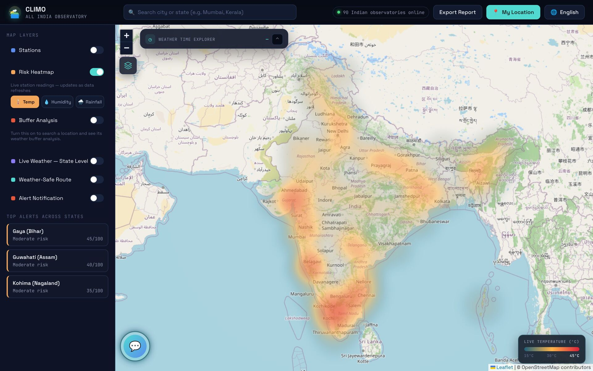</a><br><sub><b>⑤ Live heatmap</b> — temperature, humidity or rainfall drawn as a Leaflet.heat field.</sub></td>
    <td><a href="docs/assets/gallery/08-buffer-analysis.jpg">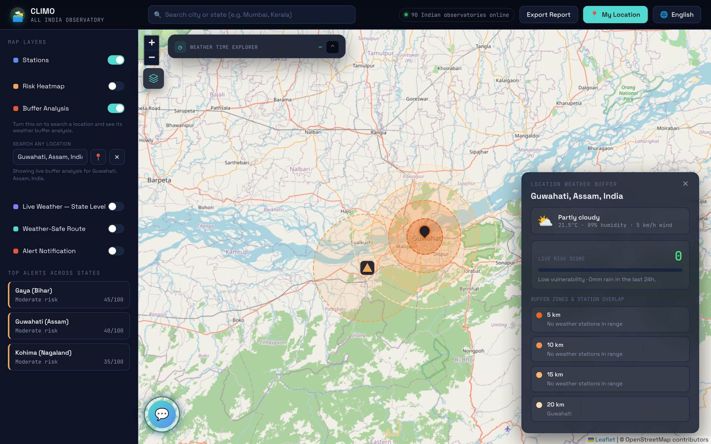</a><br><sub><b>⑥ Buffer analysis</b> — 5/10/15/20 km rings, nearby-station overlap and a live risk score for any place.</sub></td>
  </tr>
  <tr>
    <td><a href="docs/assets/gallery/10-weather-buddy.jpg">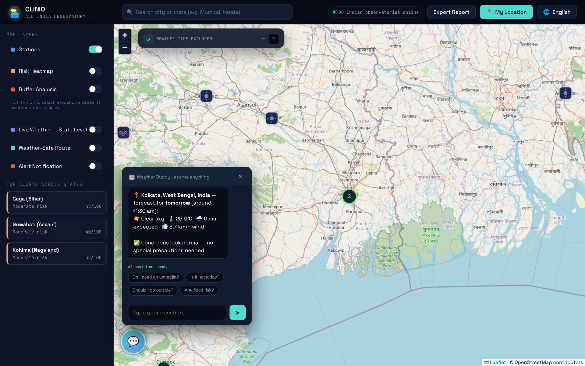</a><br><sub><b>⑦ Weather Buddy</b> — understands place names and times like "tomorrow", then gives practical advice.</sub></td>
    <td><a href="docs/assets/gallery/12-multilingual.jpg">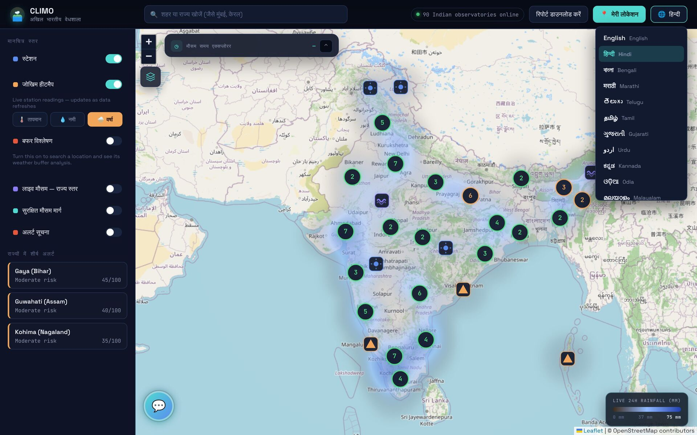</a><br><sub><b>⑧ 16 languages</b> — the whole UI switches live (shown here in Hindi over a rainfall field).</sub></td>
  </tr>
  <tr>
    <td><a href="docs/assets/gallery/13-satellite.jpg">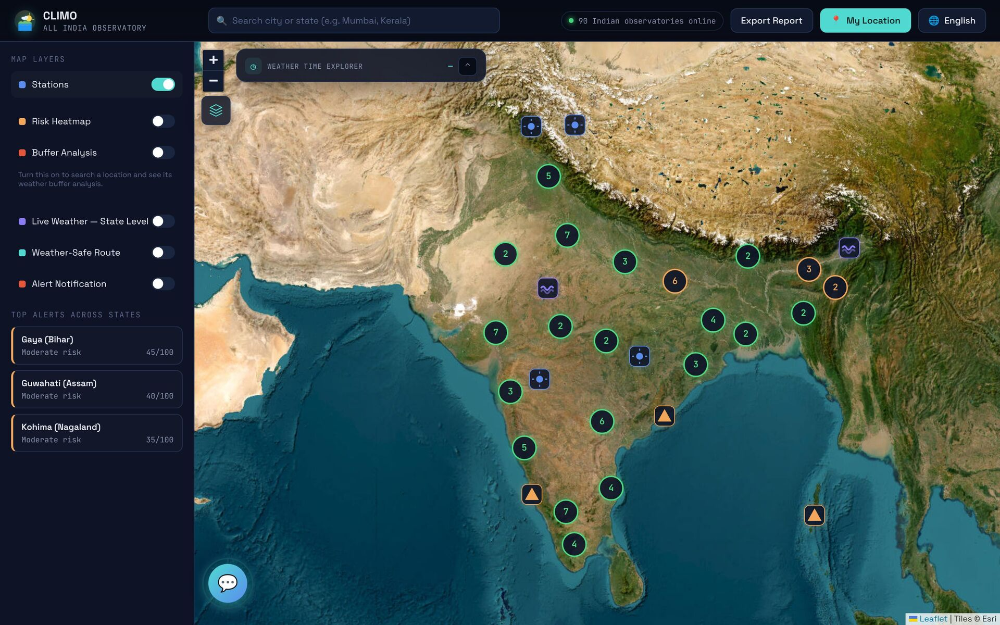</a><br><sub><b>⑨ Satellite basemap</b> — one click switches to Esri World Imagery.</sub></td>
    <td><a href="docs/assets/gallery/14-alerts.jpg">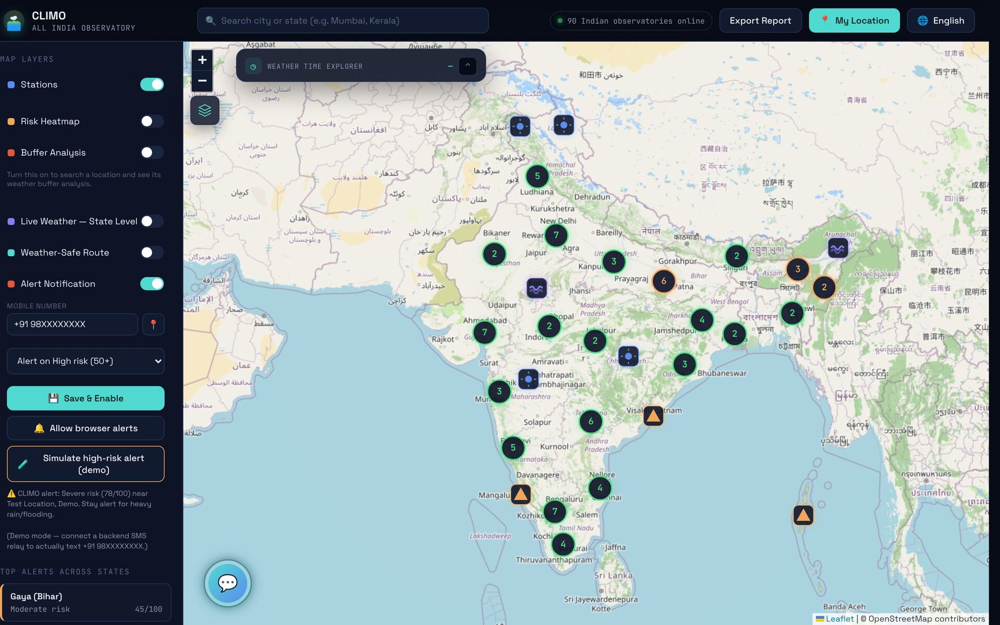</a><br><sub><b>⑩ Alerts</b> — set a risk threshold, get browser notifications and a simulated SMS relay.</sub></td>
  </tr>
</table>

<p align="center"><b>📱 Same codebase on a phone (Cordova APK or mobile browser)</b></p>

<table>
  <tr>
    <td width="25%">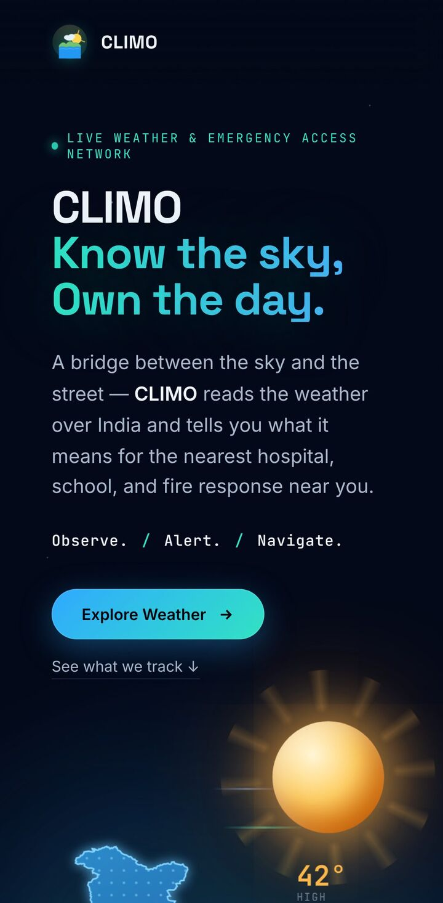</td>
    <td width="25%">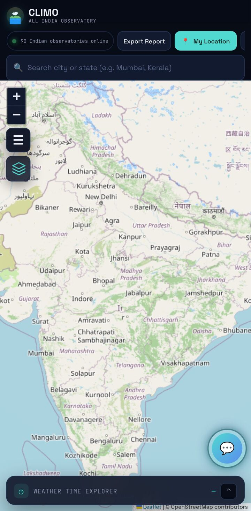</td>
    <td width="25%">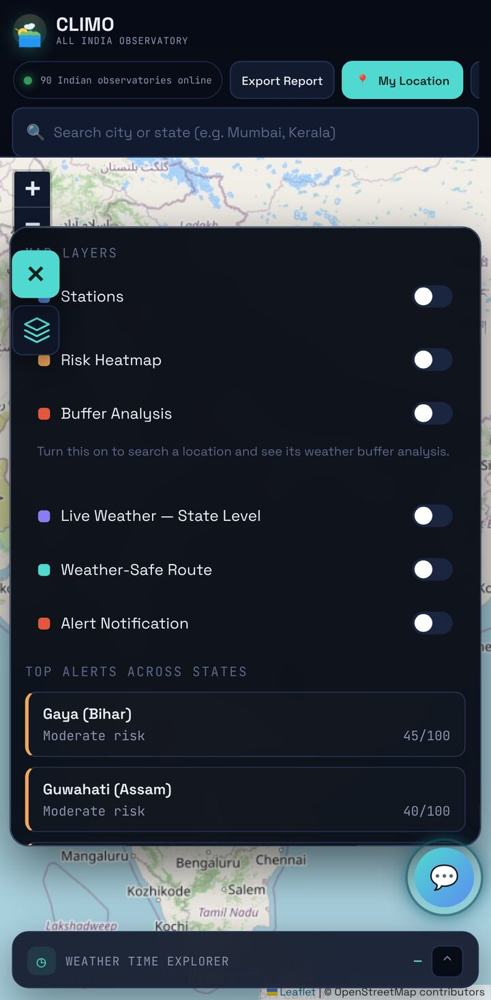</td>
    <td width="25%">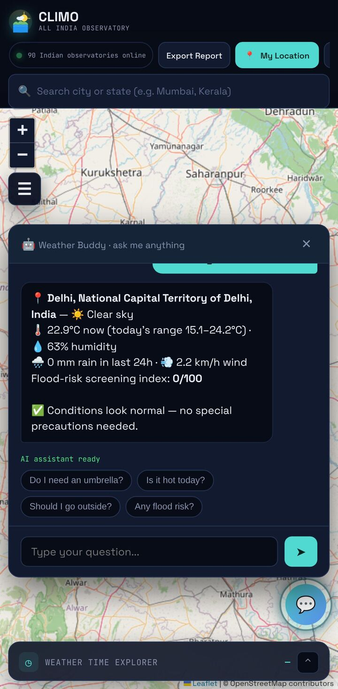</td>
  </tr>
  <tr>
    <td align="center"><sub>Landing</sub></td>
    <td align="center"><sub>Map</sub></td>
    <td align="center"><sub>Layers drawer</sub></td>
    <td align="center"><sub>Weather Buddy</sub></td>
  </tr>
</table>

---

## ✨ Features

<table>
<tr>
<td width="33%" valign="top">

#### 🛰 Observe
- **90 stations** across every region: AWS, radar, rain-gauge and river-gauge types, each with its own icon
- **Live conditions**: temperature, humidity, precipitation, wind and WMO weather code
- **Hourly strip** (past + next 24 h) and a **7-day forecast** in every station drawer
- **Click anywhere** on the map for an instant weather readout at that point
- **OSM ⇄ Satellite** basemaps

</td>
<td width="33%" valign="top">

#### 🗺 Analyze (GIS)
- **Risk heatmap**: live Temp / Humidity / Rainfall fields via `Leaflet.heat`
- **State choropleth**: live temperature, rainfall, humidity or wind averaged per state/UT, with an atmospheric canvas overlay
- **Buffer analysis**: risk-filtered 15 km station buffers, plus 5/10/15/20 km rings around *any* searched place
- **Nearest station**: Haversine nearest-neighbour lookup with a road route to it
- **CSV export** of the live national report (UTF-8 BOM, opens cleanly in Excel)

</td>
<td width="33%" valign="top">

#### ⏱ Time travel
- **Weather Time Explorer**: scrub or play through 48 h of history plus 10 days of forecast (IST-correct)
- **Climate time machine**: a **2000 → 2030** slider over 2,790 station-year records
- **Observed vs. forecast**: years after 2025 are labelled *FORECAST (LSTM)*
- **Play mode** animates the decades

</td>
</tr>
<tr>
<td valign="top">

#### 🚨 Alert
- **Flood-risk index (0–100)** for every station, recomputed live
- **Banners** for stations that cross *Moderate* (34) or *High* (66)
- **My-location alerts**: watch the nearest station; native browser notifications
- **SMS relay hook** (simulated; ready for a backend)
- **Re-scans every 5 minutes** so alerts behave like a live feed

</td>
<td valign="top">

#### 🧭 Navigate
- **Weather-safe routing** (OpenRouteService), with start/end set by search, GPS or a map pin
- Samples the road every **25 km**, scores live rainfall at each sample, and builds **avoid-polygons** for risky stations and samples
- Shows the **shortest and the safe route together**, with the time difference between them
- **My Location**: GPS plus a reverse-geocoded neighbourhood name

</td>
<td valign="top">

#### 💬 Converse & include
- **Weather Buddy**: a rule-based assistant with **no LLM and no key**. It understands place names, "near me", and times like *in 2 hours / tonight / tomorrow*
- Gives practical tips (☂ umbrella, 🧥 sweater, 🥤 hydrate)
- **Local feedback**: residents can post on-the-ground reports in each station drawer (kept on the device for now)
- **16 languages**: English, हिन्दी, বাংলা, मराठी, తెలుగు, தமிழ், ગુજરાતી, اردو, ಕನ್ನಡ, ଓଡ଼ିଆ, മലയാളം, ਪੰਜਾਬੀ, অসমীয়া, मैथिली, संस्कृतम्, कोंकणी

</td>
</tr>
</table>

---

## 🧠 How it works

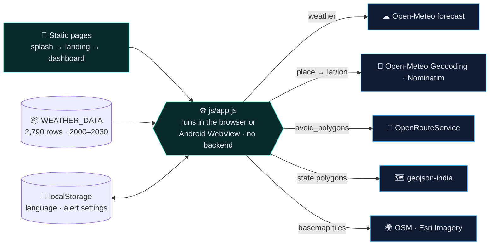

**Boot sequence:** the splash screen hands off to the landing page, then to the dashboard. The dashboard fetches all 90 stations from Open-Meteo with a **5-request concurrency pool** to stay under the rate limit, then computes risk scores and renders the markers, alert list and banners. A timer **re-anchors "now" every 5 minutes**, and a 6-second fail-safe makes sure the loading screen never hangs.

➡️ Full breakdown in **[docs/ARCHITECTURE.md](docs/ARCHITECTURE.md)**.

---

## 🌧 The risk model

CLIMO's flood-risk index is a **screening index**, not a hydrodynamic model. It is a transparent weighted sum of normalized live signals:

```text
score = 45 · min(rain_24h / 75 mm, 1)        trailing 24 h rainfall
      + 25 · min(rain_6h  / 35 mm, 1)        trailing 6 h rainfall
      + 10 · min(precip_now / 8 mm, 1)       current intensity
      + 15 · min(P(rain)_today / 80 %, 1)    today's precipitation probability
      +  5 · storm(weathercode)              95/96/99 → 1 · 80/81/82 → 0.5
```

| Band | Score | Color | Used for |
|:--|:--:|:--:|:--|
| 🟢 **Low** | 0 – 33 | `#4ADE80` | normal display |
| 🟠 **Moderate** | 34 – 65 | `#F2A65A` | alert list, buffers, route avoid-zones |
| 🔴 **High** | 66 – 100 | `#E4573D` | banners, notifications |

➡️ Derivation, route scoring, buffer logic and the (not yet wired) report-verification rules are in **[docs/RISK_MODEL.md](docs/RISK_MODEL.md)**.

---

## 🚀 Quick start

**Option 1: use it now.** Open the **[live demo](https://chakrabortysohini2005-stack.github.io/Web-Mobile-Application-CLIMO/)**.

**Option 2: run it locally.** It is plain static files, so any web server works:

```bash
git clone https://github.com/chakrabortysohini2005-stack/Web-Mobile-Application-CLIMO.git
```

```bash
cd Web-Mobile-Application-CLIMO
```

```bash
python3 -m http.server 8080
```

Then open <http://localhost:8080>. The root page redirects to the app.

> 💡 You can even double-click `CLIMO-fixed/CLIMO-project/CLIMO_backend.html`, because every data API it calls is CORS-enabled. Use a local server (`localhost` is a secure context) if you want GPS and notifications to work.

**Option 3: Android APK.** Every push to `main` builds a debug APK with Apache Cordova. Download the **`climo-app-debug-apk`** artifact from the [Actions tab](https://github.com/chakrabortysohini2005-stack/Web-Mobile-Application-CLIMO/actions/workflows/android.yml). Build steps are in **[docs/DEPLOYMENT.md](docs/DEPLOYMENT.md)**.

---

## 🗂 Project structure

```text
Web-Mobile-Application-CLIMO/
├── index.html                      ↪ GitHub Pages entry: redirects into the app
├── .github/workflows/android.yml   🤖 CI: wraps the web app in Cordova → debug APK
├── CLIMO-fixed/CLIMO-project/      🌦 the application
│   ├── index.html                  ✦ animated splash (starfield → auto-advance in 2.6 s)
│   ├── CLIMO.html                  ✦ landing page (3D parallax India, features, CTA)
│   ├── CLIMO_backend.html          ✦ the GIS dashboard
│   ├── css/
│   │   ├── index.css               splash styles
│   │   ├── climo.css               landing styles
│   │   └── app.css                 dashboard design system (dark theme, responsive)
│   └── js/
│       ├── index.js                splash logic
│       ├── climo.js                landing: wind streams + 3D tilt
│       └── app.js                  ★ the engine: i18n, 90 stations, risk, layers,
│                                     routing, time explorer, assistant, alerts
│                                     (+ embedded 2000–2030 WEATHER_DATA)
└── docs/                           📚 documentation & gallery assets
```

---

## 📚 Documentation

| Doc | What's inside |
|:--|:--|
| 🖼 **[Gallery](docs/GALLERY.md)** · [interactive](docs/gallery.html) | Every screen at full size, with captions |
| 📖 **[User guide](docs/USER_GUIDE.md)** | A walkthrough of each panel, layer and control |
| 🏗 **[Architecture](docs/ARCHITECTURE.md)** | Modules, data flow, boot sequence, state, external services |
| 🌧 **[Risk model](docs/RISK_MODEL.md)** | Flood index, route scoring, buffers, report verification |
| 🗃 **[Data](docs/DATA.md)** | Station registry, climate dataset dictionary, API contracts |
| 🚢 **[Deployment](docs/DEPLOYMENT.md)** | GitHub Pages, local hosting, Cordova APK, CI |
| 🤝 **[Contributing](CONTRIBUTING.md)** | Setup, conventions, adding a station or language |
| 🔐 **[Security](SECURITY.md)** | Reporting, the client-side key, privacy notes |
| 📝 **[Changelog](CHANGELOG.md)** | Project history |

---

## 🛣 Roadmap

- [x] Live all-India station network with flood-risk scoring
- [x] Heatmaps, state choropleth, buffer analysis, satellite basemap
- [x] Weather-safe routing with avoid-polygons
- [x] 2000–2030 climate time machine (observed + LSTM forecast)
- [x] 16-language UI and a rule-based Weather Buddy
- [x] Android APK through CI
- [ ] Real SMS relay (serverless function) to replace the simulated one
- [ ] Persist and share community feedback (it currently stays on the device)
- [ ] Restrict assistant geocoding to India (e.g. *Kochi* can resolve to Japan)
- [ ] Move the routing key behind a proxy ([SECURITY.md](SECURITY.md))
- [ ] Map hospitals, schools and fire stations (promised on the landing page)
- [ ] Offline cache / PWA install
- [ ] Split `app.js` into modules and load `WEATHER_DATA` from JSON

---

## 🙏 Acknowledgements

CLIMO stands on generous open infrastructure:
[Open-Meteo](https://open-meteo.com/) (weather and geocoding) ·
[OpenStreetMap](https://www.openstreetmap.org/copyright) contributors and [Nominatim](https://nominatim.org/) ·
[Esri World Imagery](https://www.arcgis.com/home/item.html?id=10df2279f9684e4a9f6a7f08febac2a9) ·
[Leaflet](https://leafletjs.com/), [Leaflet.markercluster](https://github.com/Leaflet/Leaflet.markercluster) and [Leaflet.heat](https://github.com/Leaflet/Leaflet.heat) ·
[OpenRouteService](https://openrouteservice.org/) ·
[geojson-india](https://www.npmjs.com/package/geojson-india) ·
[Apache Cordova](https://cordova.apache.org/).

## 📄 License

This repository has **no license file yet**, so by default all rights are reserved by the author. If you want others to reuse the code, add a `LICENSE` file (MIT is a common choice for projects like this). The map data and APIs listed above keep their own terms and attribution requirements.

<p align="center">
  <br>
   
   
  
  <br><br>
  <sub>Built with ☀️ for India by <a href="https://github.com/chakrabortysohini2005-stack">chakrabortysohini2005-stack</a> · <b>Know the sky, Own the day.</b></sub>
</p>
