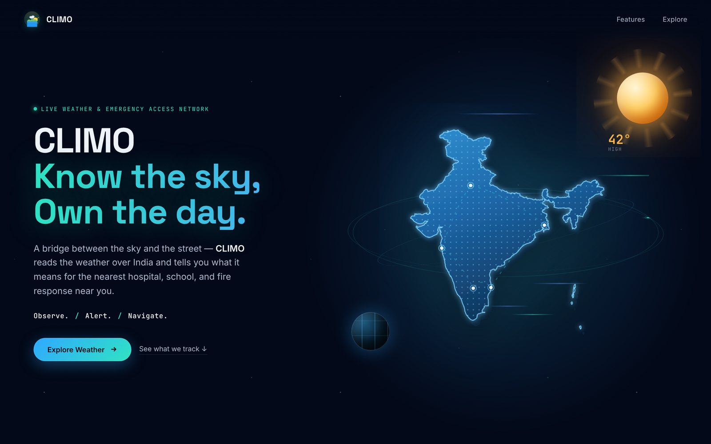
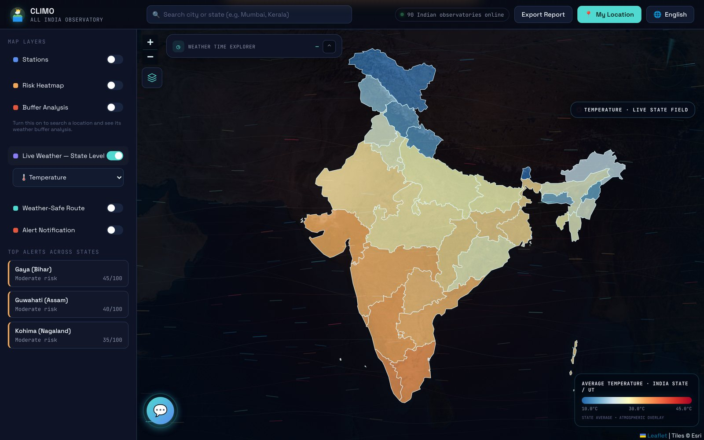
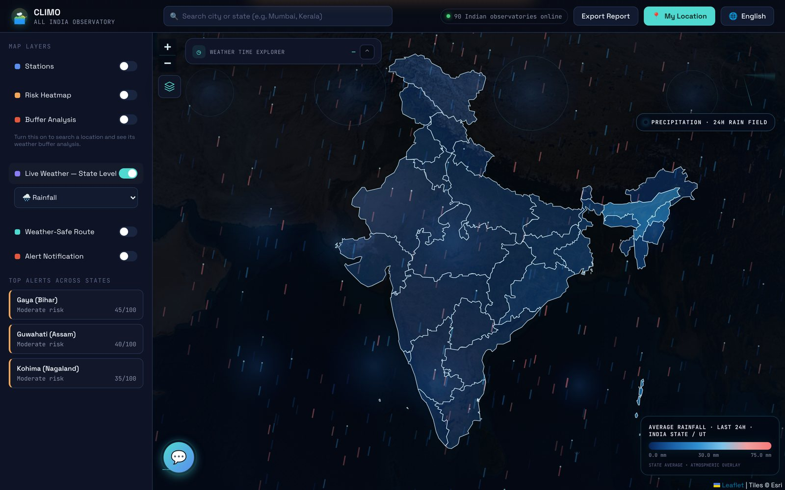
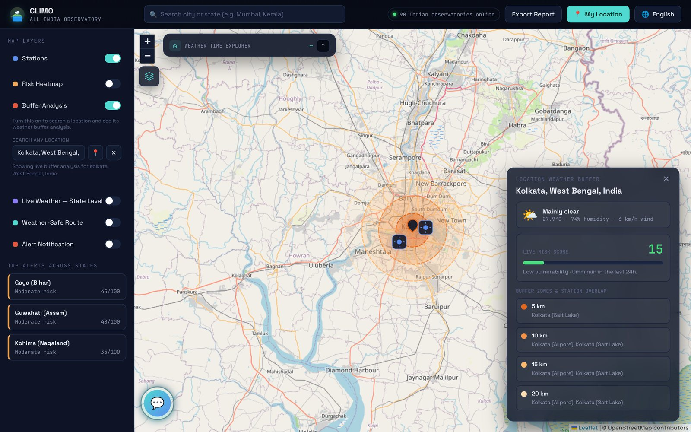
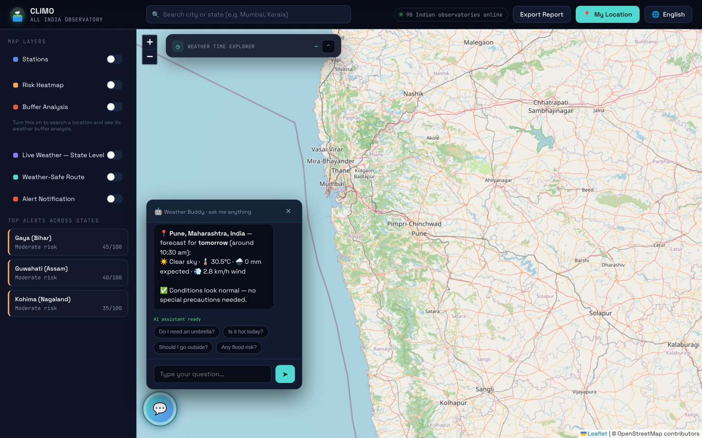
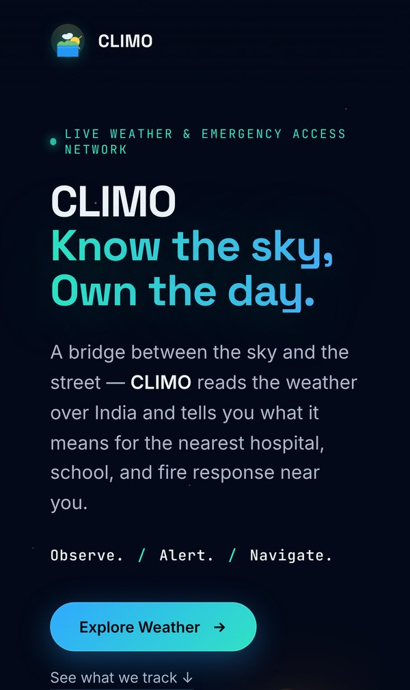
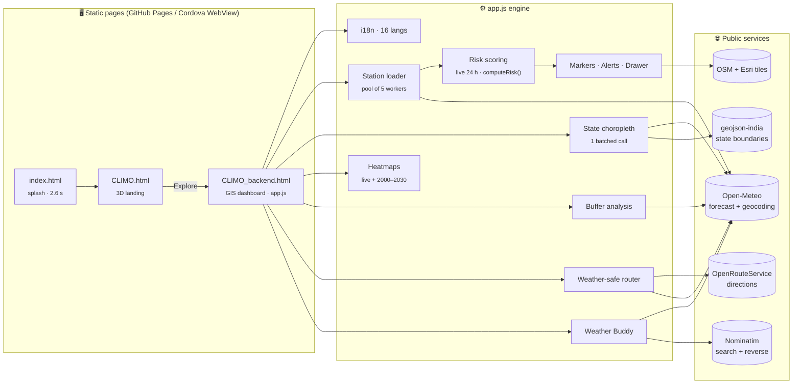

<!-- ============================================================= -->
<!--                         C L I M O                              -->
<!--            Know the sky, Own the day.  ·  All-India GIS        -->
<!-- ============================================================= -->

<p align="center">
  
</p>

<p align="center">
  <a href="https://chakrabortysohini2005-stack.github.io/Web-Mobile-Application-CLIMO/"></a>
  <a href="https://github.com/chakrabortysohini2005-stack/Web-Mobile-Application-CLIMO/actions/workflows/android.yml"></a>
  <a href="docs/GALLERY.md"></a>
</p>

<p align="center">
  
  
  
  
  
  
  
  
  
  
</p>

<p align="center">
  <b><a href="#-what-is-climo">About</a></b> ·
  <b><a href="#-gallery">Gallery</a></b> ·
  <b><a href="#-features">Features</a></b> ·
  <b><a href="#-how-the-risk-score-works">Risk model</a></b> ·
  <b><a href="#-architecture">Architecture</a></b> ·
  <b><a href="#-quick-start">Quick start</a></b> ·
  <b><a href="#-android-app">Android</a></b> ·
  <b><a href="#-documentation">Docs</a></b>
</p>

---

## 🌏 What is CLIMO?

> **A bridge between the sky and the street.**
> CLIMO reads the weather over India and turns it into decisions: *is it safe to go out, which road should I take, is my neighbourhood about to flood?*

CLIMO is a **live, all-India weather and risk GIS** that runs entirely in the browser and also ships as an **Android app**. It watches **90 weather stations across 33 states and union territories**, scores each one for flood risk every time the clock moves, and puts the results on a map you can explore, filter, search, scrub through time, ask questions of, and use in **16 Indian languages**.

<table>
<tr>
<td width="25%" align="center"><h3>👁️ Observe</h3><sub>Live readings from 90 stations, state-level choropleths, heatmaps, and a 2000 → 2030 climate timeline.</sub></td>
<td width="25%" align="center"><h3>⚠️ Alert</h3><sub>A 0–100 flood-risk score per station, an alert banner, browser notifications and a per-location watch.</sub></td>
<td width="25%" align="center"><h3>🧭 Navigate</h3><sub>Weather-safe A → B routing that detours around risky stretches of the road.</sub></td>
<td width="25%" align="center"><h3>💬 Ask</h3><sub><i>Weather Buddy</i> answers plain-language questions like “will it rain in Pune tomorrow?”</sub></td>
</tr>
</table>

<p align="center"></p>

---

## 📸 Gallery

> Every screenshot below was captured from the real app running against **live Open-Meteo data**. See the **[full gallery →](docs/GALLERY.md)** or open the **[interactive lightbox gallery →](docs/gallery.html)**.

<p align="center">
  
  <br/><sub><b>🎞️ 2000 → 2030 climate timelapse.</b> The year slider replays 26 years of observed station climate, then rolls into the LSTM forecast from 2026.</sub>
</p>

<table>
  <tr>
    <td width="33%"><p align="center"><b>Station network</b><br/><sub>90 clustered stations colour-coded by type</sub></p></td>
    <td width="33%"><p align="center"><b>Live state choropleth</b><br/><sub>Temperature, rain, humidity, wind</sub></p></td>
    <td width="33%"><p align="center"><b>Animated atmosphere</b><br/><sub>Canvas rain, wind and heat particles</sub></p></td>
  </tr>
  <tr>
    <td width="33%"><p align="center"><b>Live heatmap</b><br/><sub>Temp, humidity and rainfall from live readings</sub></p></td>
    <td width="33%"><p align="center"><b>Buffer analysis</b><br/><sub>5 / 10 / 15 / 20 km rings around any place</sub></p></td>
    <td width="33%"><p align="center"><b>Satellite basemap</b><br/><sub>One-tap switch from OSM to Esri imagery</sub></p></td>
  </tr>
  <tr>
    <td width="33%"><p align="center"><b>Station drawer</b><br/><sub>Hourly strip, 7-day outlook, risk gauge</sub></p></td>
    <td width="33%"><p align="center"><b>Weather Buddy</b><br/><sub>Plain-language Q&amp;A on live data</sub></p></td>
    <td width="33%"><p align="center"><b>16 languages</b><br/><sub>Hindi, Bengali, Tamil, Urdu and more</sub></p></td>
  </tr>
</table>

<p align="center">
  
  &nbsp;
  
  &nbsp;
  
  <br/><sub><b>📱 One responsive codebase:</b> the same pages run on desktop, mobile browsers and inside the Android app.</sub>
</p>

---

## ✨ Features

<table>
<tr><th align="left">Layer / tool</th><th align="left">What it does</th><th align="left">Powered by</th></tr>
<tr><td>📡 <b>Stations</b></td><td>90 stations (35 AWS, 24 rain gauges, 19 river gauges, 12 radar) with live conditions, 48 h history and a 10-day forecast. Markers cluster as you zoom out.</td><td>Open-Meteo forecast API · Leaflet.markercluster</td></tr>
<tr><td>🔥 <b>Risk heatmap</b></td><td>A live Leaflet.heat surface for temperature, humidity or 24 h rainfall, built from each station's current reading.</td><td>Leaflet.heat</td></tr>
<tr><td>🗺️ <b>Live weather: state level</b></td><td>A choropleth of every state and UT for temperature, rainfall, humidity or wind, filled by <i>one</i> batched API call. Areas outside India are masked, and an animated canvas adds rain, wind and heat particles.</td><td>geojson-india · Open-Meteo multi-point · Canvas 2D</td></tr>
<tr><td>⭕ <b>Buffer analysis</b></td><td>15 km risk-coloured buffers around stations, or 5/10/15/20 km rings around <i>any</i> searched place, listing which stations each ring overlaps.</td><td>Haversine distance · Open-Meteo geocoding</td></tr>
<tr><td>🧭 <b>Weather-safe route</b></td><td>Samples the shortest road route every ~25 km, checks live rainfall at each point, turns risky points into avoid-polygons and asks the router for a detour. Draws both routes so you can compare them.</td><td>OpenRouteService · Open-Meteo</td></tr>
<tr><td>🔔 <b>Alert notification</b></td><td>Watches the station nearest to you and fires an in-app banner plus a browser notification when risk crosses your threshold (34 / 50 / 66). The SMS hook is stubbed and ready for a backend relay.</td><td>Notification API · localStorage</td></tr>
<tr><td>⏱️ <b>Weather time explorer</b></td><td>Scrub or play from 48 h ago to 10 days ahead. The whole map, the alerts and the drawer update to that hour.</td><td>Hourly forecast series (pinned to IST)</td></tr>
<tr><td>📈 <b>2000 → 2030 climate slider</b></td><td>Replays annual temperature, humidity and rainfall for 90 stations, with observed data up to 2025 and an LSTM forecast for 2026–2030.</td><td>Embedded <i>India Climate Pulse</i> dataset (2,790 rows)</td></tr>
<tr><td>💬 <b>Weather Buddy</b></td><td>A local, rule-based assistant. It understands places, “my location”, and times like “in 2 hours”, “tonight” or “tomorrow”, and answers with actionable tips (“take an umbrella”). It uses no LLM and no API key.</td><td>Open-Meteo · Nominatim · Geolocation</td></tr>
<tr><td>🔎 <b>Smart search</b></td><td>Finds stations instantly and falls back to India-wide place search. The map flies to the result and opens its drawer.</td><td>Nominatim (countrycodes=in)</td></tr>
<tr><td>📍 <b>Click anywhere</b></td><td>When idle, click any point on the map to get its live weather and reverse-geocoded address.</td><td>Open-Meteo · Nominatim reverse</td></tr>
<tr><td>📄 <b>Export report</b></td><td>Downloads a UTF-8 CSV of every station's temperature, humidity, rain, wind and risk. It also works inside the Android WebView.</td><td>data: URI download</td></tr>
<tr><td>🗣️ <b>16 languages</b></td><td>English, हिन्दी, বাংলা, मराठी, తెలుగు, தமிழ், ગુજરાતી, اردو, ಕನ್ನಡ, ଓଡ଼ିଆ, മലയാളം, ਪੰਜਾਬੀ, অসমীয়া, मैथिली, संस्कृतम्, कोंकणी. Your choice is remembered.</td><td>Built-in i18n table</td></tr>
<tr><td>🛰️ <b>Basemaps</b></td><td>OpenStreetMap ⇄ Esri World Imagery.</td><td>Leaflet tile layers</td></tr>
<tr><td>🗨️ <b>Local feedback</b></td><td>Residents can post on-the-ground updates (“waterlogging”, “road blocked”) in a station's drawer.</td><td>In-page feed</td></tr>
</table>

> 📖 A step-by-step tour of every control is in the **[User Guide](docs/USER_GUIDE.md)**.

---

## 🧮 How the risk score works

CLIMO turns weather into a **0–100 flood-risk score**. It does this in two complementary ways:

**① Live station score.** This drives the markers, *Top alerts*, banners, buffers, route avoid-zones and your location alert. It is recomputed for every station each time the timeline moves:

```text
live(t) = min(100, round( Σ rain[t-23 … t] / 75 mm × 100 ))      ← rolling 24 h at the selected hour
```

**② Multi-factor screening index, `computeRisk()`.** CLIMO uses this for places you search or click, for buffer-location insights, for Weather Buddy, and as a fallback before the timeline is ready:

<p align="center"></p>

```text
score = 45·min(rain24h/75mm, 1) + 25·min(rain6h/35mm, 1) + 15·min(pop/80%, 1)
      + 10·min(nowRain/8mm, 1)  +  5·storm(WMO 95/96/99 → 1, 80–82 → 0.5)
```

| Band | Score | Colour | What CLIMO does |
|---|---|---|---|
| 🟢 Low | 0 – 33 | `#4ADE80` | Green marker. Scores of 20 or more still appear in *Top alerts*. |
| 🟠 Moderate | 34 – 65 | `#F2A65A` | Alert banner, a 15 km buffer, and an avoid-zone when routing |
| 🔴 High | 66 – 100 | `#E4573D` | All of the above, in red. The default location alert fires at 50. |

> ⚠️ This is an **operational screening index**, not a hydrodynamic flood model. The full method, its limits, the buffer geometry and the routing algorithm are in **[METHODOLOGY.md](docs/METHODOLOGY.md)**.

---

## 🏗️ Architecture

CLIMO is a **zero-build, zero-backend static web app**. Three pages, three stylesheets and three scripts talk directly to free, CORS-enabled public APIs.



<details>
<summary><b>📂 Repository layout</b></summary>

```text
Web-Mobile-Application-CLIMO/
├── index.html                       # Root redirect so GitHub Pages lands on the app
├── .github/workflows/android.yml    # CI: wraps the web app with Cordova → debug APK
├── CLIMO-fixed/CLIMO-project/
│   ├── index.html                   # Animated splash screen → CLIMO.html
│   ├── CLIMO.html                   # Landing page: 3D India, orbiting sun, feature grid
│   ├── CLIMO_backend.html           # The GIS dashboard shell (Leaflet + panels)
│   ├── css/
│   │   ├── index.css                # Splash styles
│   │   ├── climo.css                # Landing styles (3D scene, parallax, glow)
│   │   └── app.css                  # Dashboard styles (≈1.1k lines, responsive)
│   └── js/
│       ├── index.js                 # Starfield + auto/tap-to-skip navigation
│       ├── climo.js                 # Wind streams, 3D parallax tilt, idle float
│       └── app.js                   # ≈4k-line engine: data, risk, layers, routing, AI, i18n
└── docs/                            # ← this documentation, gallery and assets
```
</details>

> 🔬 Module-by-module internals, the boot sequence and data flow are in **[ARCHITECTURE.md](docs/ARCHITECTURE.md)**.

---

## 🚀 Quick start

CLIMO has **no dependencies to install**. Any static file server will do.

```bash
git clone https://github.com/chakrabortysohini2005-stack/Web-Mobile-Application-CLIMO.git
```

```bash
cd Web-Mobile-Application-CLIMO
```

```bash
python3 -m http.server 8080
```

Then open **http://localhost:8080/**. The root page redirects you to the splash screen, then the landing page, then the dashboard.

<details>
<summary><b>Other ways to serve it</b></summary>

```bash
npx serve .
```

You can also use the VS Code **Live Server** extension. Opening `CLIMO_backend.html` straight from disk (`file://`) mostly works too, because every API CLIMO calls is CORS-enabled.
</details>

<details>
<summary><b>🔑 Optional: your own routing key</b></summary>

The weather-safe route planner uses [OpenRouteService](https://openrouteservice.org/dev/#/signup) (free tier). Set your key in `ORS_CONFIG.apiKey` near the top of `js/app.js`. Every other feature needs **no key at all**. See [SECURITY.md](SECURITY.md) for how to handle keys safely.
</details>

---

## 📱 Android app

Every push or pull request to `main` triggers **[`.github/workflows/android.yml`](.github/workflows/android.yml)**, which:

1. sets up Node 20 and installs **Apache Cordova**,
2. scaffolds a Cordova project (`com.climo.webapp`) and copies the web app into `www/`,
3. adds the Android platform and builds with **JDK 17**,
4. uploads **`climo-app-debug-apk`** as a workflow artifact.

➡️ **Actions** tab → latest *Build CLIMO Web App to APK* run → **Artifacts** → download and sideload.

The app is WebView-aware: CSV export detects Android WebView (`; wv)` in the user agent) and hands the file to the system downloader.

> 📦 Local Cordova builds, release signing and GitHub Pages setup are covered in **[DEPLOYMENT.md](docs/DEPLOYMENT.md)**.

---

## 📚 Documentation

| Doc | What's inside |
|---|---|
| 📸 [**GALLERY.md**](docs/GALLERY.md) · [**gallery.html**](docs/gallery.html) | Every screen, desktop and mobile, with captions. The HTML version has a lightbox. |
| 🧭 [**USER_GUIDE.md**](docs/USER_GUIDE.md) | A tour of every layer, button and panel |
| 🏗️ [**ARCHITECTURE.md**](docs/ARCHITECTURE.md) | Pages, modules, boot sequence, state and data flow |
| 🧮 [**METHODOLOGY.md**](docs/METHODOLOGY.md) | Risk index, buffers, weather-safe routing, climate dataset and limitations |
| 🌐 [**DATA_SOURCES.md**](docs/DATA_SOURCES.md) | Every external API and dataset, with attribution and rate limits |
| 🚢 [**DEPLOYMENT.md**](docs/DEPLOYMENT.md) | Local, GitHub Pages and Android (CI and local Cordova) |
| 🤝 [**CONTRIBUTING.md**](CONTRIBUTING.md) | Workflow, code style, adding a language or station |
| 🔐 [**SECURITY.md**](SECURITY.md) | API keys, the SMS relay, privacy and reporting issues |
| 📝 [**CHANGELOG.md**](CHANGELOG.md) | Project history |

---

## 🛣️ Roadmap

- [ ] Move the OpenRouteService key behind a tiny serverless proxy
- [ ] Real SMS delivery through a backend relay (Twilio / MSG91 / Fast2SMS)
- [ ] Re-fetch station data periodically, not only at boot
- [ ] Share citizen feedback across users (it currently stays in the page)
- [ ] PWA manifest and service worker for offline use
- [ ] Signed release APK, and a Play Store listing
- [ ] Split `app.js` into ES modules and add unit tests for `computeRisk()` and the routing helpers

---

## 🙏 Credits

Weather data from **[Open-Meteo](https://open-meteo.com/)** (CC BY 4.0). Map data © **[OpenStreetMap](https://www.openstreetmap.org/copyright)** contributors. Imagery © **Esri**, Maxar, Earthstar Geographics. Routing by **[OpenRouteService](https://openrouteservice.org/)**. Geocoding by **[Nominatim](https://nominatim.org/)**. State boundaries from **[geojson-india](https://www.npmjs.com/package/geojson-india)**. Maps by **[Leaflet](https://leafletjs.com/)**, with Leaflet.markercluster and Leaflet.heat.

<p align="center">
  
</p>

<p align="center">
  <b>CLIMO</b> · <i>Know the sky, Own the day.</i><br/>
  <sub>Observe · Alert · Navigate</sub>
</p>
