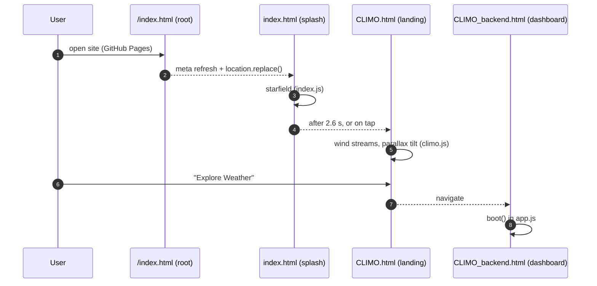
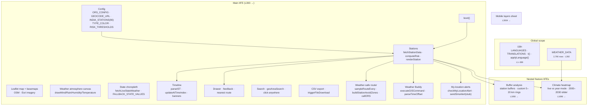
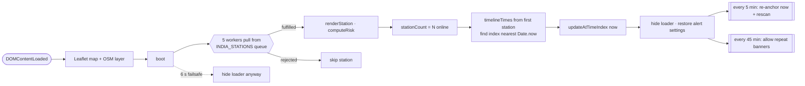
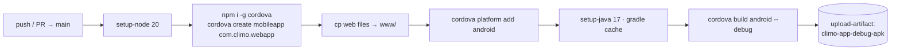

# 🏗️ CLIMO Architecture

> How a zero-build, zero-backend static site becomes an all-India GIS. File paths are relative to `CLIMO-fixed/CLIMO-project/`, and line numbers refer to `js/app.js` at the time of writing.

---

## 1. Design principles

| Principle | How CLIMO applies it |
|---|---|
| **No build, no backend** | Plain HTML, CSS and JS. It deploys to GitHub Pages as-is and drops into Cordova's `www/` unchanged. |
| **Key-free by default** | Every core feature uses CORS-enabled, keyless APIs (Open-Meteo, Nominatim, OSM tiles). Only routing needs a key. |
| **One codebase, every screen** | The responsive CSS and a mobile layers sheet (`initMobileLayers`) cover desktop, mobile web and the Android WebView. |
| **Graceful degradation** | The loader fails safe after 6 s, the state choropleth falls back to estimates, partial station loads still render, and an offline load shows *“No internet — map only”*. |
| **Respect rate limits** | A pool of 5 station-loading workers, one *batched* multi-point call for all state centroids, and route sampling every 25 km. |

---

## 2. Page flow

| Page | CSS | JS | Lines (HTML / CSS / JS) |
|---|---|---|---|
| `index.html` | `css/index.css` | `js/index.js` | 56 / 92 / 22 |
| `CLIMO.html` | `css/climo.css` | `js/climo.js` | 240 / 475 / 56 |
| `CLIMO_backend.html` | `css/app.css` + Leaflet CSS | Leaflet, markercluster, heat + `js/app.js` | 286 / 1148 / 3968 |

---

## 3. Inside `app.js`

`app.js` is organised as a few top-level blocks plus one main IIFE that contains further nested IIFEs. This keeps state private while every feature shares the same Leaflet `map`.

### Module reference

| Module | Key functions | Responsibility |
|---|---|---|
| **i18n** | `t()`, `applyLanguage()`, `buildLangMenu()` | Swaps `data-i18n` text and `data-i18n-placeholder` attributes, and persists `climoLang` |
| **Station catalogue** | `INDIA_STATIONS` | 90 entries `{id, code, name, state, type, lat, lon}` with WMO/IMD-style IDs |
| **Data fetch** | `fetchStationData()` | Open-Meteo `current`, `hourly`, `daily` · `past_days=2` · `forecast_days=10` · `timezone=Asia/Kolkata` |
| **Risk** | `computeRisk()`, `riskColor()`, `riskLabel()` | The 0–100 index and its bands (see [METHODOLOGY.md](METHODOLOGY.md)) |
| **Rendering** | `makeIcon()`, `renderStation()`, `renderAlerts()` | Type-coloured SVG icons, the cluster layer, and the top-alerts list |
| **Time** | `parseIST()`, `updateAtTimeIndex()` | Re-scores every station at the selected hour and queues banners |
| **Banners** | `queueBanner()`, `showNextBanner()`, `maybeNativeNotify()` | One banner at a time, plus the Notification API |
| **Choropleth** | `showWeatherChoropleth()`, `fetchLiveStateWeather()`, `interpolateColor()` | Loads the state GeoJSON, makes one batched multi-point request, masks everything outside India, and shows the legend |
| **Atmosphere** | `setAtmosphere()`, `atmosphereFrame()` | A `requestAnimationFrame` particle system on a canvas overlay |
| **Climate heatmap** | `renderClimateHeatmapLive()`, `renderClimateHeatmapForYear()` | One shared `climateHeatLayer`. The control touched most recently wins. |
| **Buffers** | `drawStationBuffers()`, `drawCustomLocationBuffers()`, `countOverlappingStations()` | Geodesic circles and overlap counts |
| **Routing** | `fetchWeatherSafeRoute()`, `fetchRouteWeatherRisk()`, `circleToRing()` | Baseline route → sampling → avoid polygons → detour |
| **Search** | `runSearch()`, `geoAreaSearch()`, `selectArea()` | Local match first, then Nominatim (`countrycodes=in`) |
| **Assistant** | `executeGISCommand()`, `extractLocationFromQuery()`, `formatHourlyAnswer()`, `buildSuggestions()` | Regex intent routing and place extraction with stop-words |
| **Alerts** | `restoreSmsAlertSettings()`, `checkMyLocationAlert()`, `sendSmsAlert()` | Threshold watch on one station. SMS is a stub. |
| **Export** | `triggerFileDownload()` | A base64 `data:` URI, routed through `window.open` inside Android WebView |

---

## 4. Boot sequence

Notes:
- **Data is fetched once at boot.** The 5-minute interval re-anchors “now” in the 12-day hourly series and re-scores; it does not re-download. Periodic refresh is on the [roadmap](../README.md#-roadmap).
- **Timezone safety:** Open-Meteo returns IST wall-clock strings with no offset. `parseIST()` appends `+05:30`, so the slider is correct in any browser timezone.

---

## 5. State and persistence

| Where | Key / variable | Holds |
|---|---|---|
| `localStorage` | `climoLang` | The chosen UI language |
| `localStorage` | `climo_sms_alert` | `{phone, threshold, …}` for the location alert |
| Memory | `markers{}` | `id → {marker, station}`, with `station.data`, `station.risk` and `station._liveScore` |
| Memory | `stateLiveWeather` (Map) | Normalised state name → live metrics |
| Memory | `CLIMATE_BY_STATION_YEAR` | `Station_ID → Year → row`, indexed from `WEATHER_DATA` |
| DOM | `#fbFeed` | Citizen feedback (not persisted or shared) |

All `localStorage` access is wrapped in `try/catch`, because it can throw in sandboxed WebViews.

---

## 6. External calls

| Call | Endpoint | When | Volume |
|---|---|---|---|
| Station weather | `api.open-meteo.com/v1/forecast` | Boot | 90 (5 concurrent) |
| State weather | `api.open-meteo.com/v1/forecast?latitude=a,b,c…` | Choropleth on | **1** batched |
| Route rainfall | same, multi-point | Route search | 1 per route (samples every 25 km) |
| Place weather | same | Assistant, buffer search, map click | 1 each |
| Geocoding | `geocoding-api.open-meteo.com/v1/search` | Route and buffer autocomplete | Per keystroke (debounced) |
| Search / reverse | `nominatim.openstreetmap.org` | Search bar, My Location, click | 1 each |
| Directions | `api.openrouteservice.org/v2/directions/driving-car/geojson` | Route search, nearest-station route | 1–2 |
| Boundaries | `cdn.jsdelivr.net/npm/geojson-india@0.0.2/india.json` | Choropleth on | 1 |
| Tiles | `tile.openstreetmap.org`, `server.arcgisonline.com` | Map pan/zoom | Many |

More on each source, its terms and its limits is in [DATA_SOURCES.md](DATA_SOURCES.md).

---

## 7. CI/CD

GitHub Pages serves the repo root. The root `index.html` redirects to `CLIMO-fixed/CLIMO-project/index.html`.
