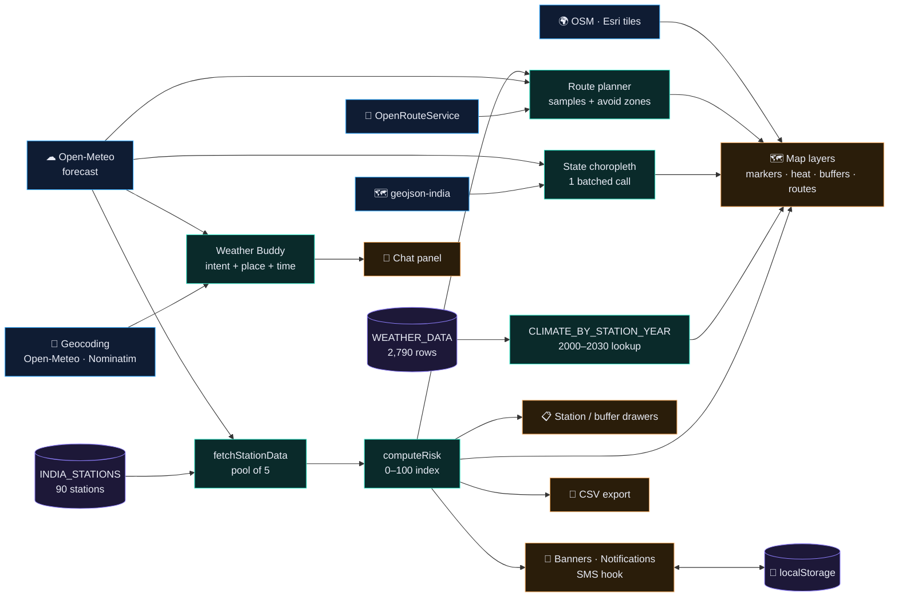
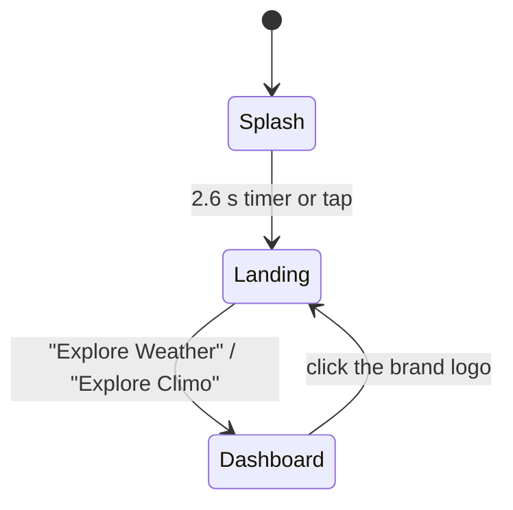
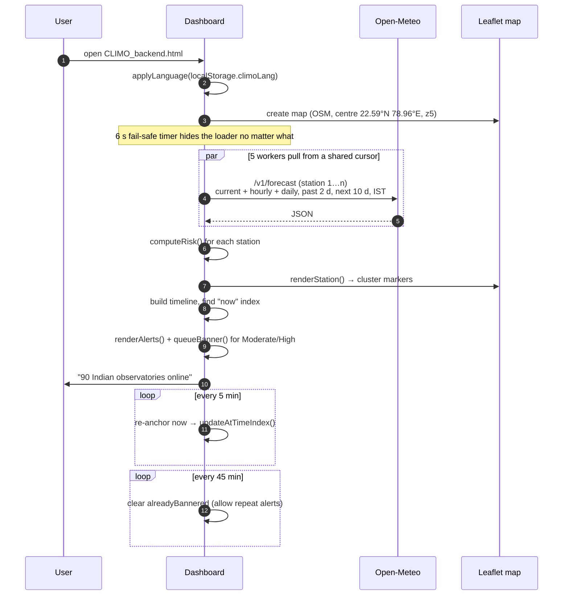
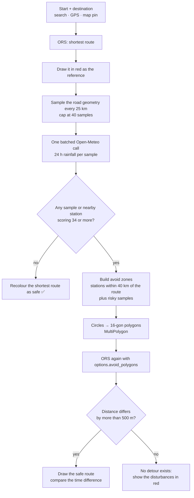
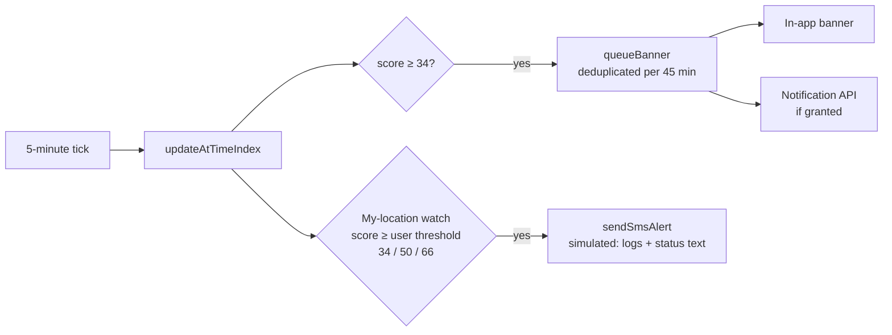

# 🏗 Architecture

> CLIMO is a **zero-backend, zero-build** single-page GIS. Everything runs in the browser, or in an Android WebView when it is packaged with Cordova. Live data comes from public, CORS-enabled APIs. Historical and forecast climate data is embedded in the JavaScript bundle.

**Contents:** [System overview](#-system-overview) · [Page flow](#-page-flow) · [The engine: `app.js`](#-the-engine-appjs) · [Boot sequence](#-boot-sequence) · [Map layers](#-map-layers) · [Weather-safe routing](#-weather-safe-routing) · [Weather Buddy](#-weather-buddy) · [Alerts](#-alerts) · [i18n](#-internationalisation) · [State & storage](#-state--storage) · [External services](#-external-services) · [Design system](#-design-system) · [Constraints](#-design-decisions--constraints)

---

## 🌐 System overview

🟦 external services · 🟪 embedded/local data · 🟩 engine (`js/app.js`) · 🟧 what the user sees

---

## 🧭 Page flow

| Step | File | Purpose | Script |
|:--:|:--|:--|:--|
| 0 | `/index.html` (repo root) | GitHub Pages entry. Redirects with `<meta refresh>`, `location.replace` and a fallback link | inline |
| 1 | `CLIMO-project/index.html` | Splash: animated logo and starfield. Auto-advances after **2.6 s**, or on tap | `js/index.js` |
| 2 | `CLIMO-project/CLIMO.html` | Landing page: 3D parallax India map, wind streams, feature grid, "Explore" CTA | `js/climo.js` |
| 3 | `CLIMO-project/CLIMO_backend.html` | **GIS dashboard**: top bar, layer sidebar, map, drawers, time explorer, assistant | `js/app.js` |

---

## ⚙ The engine: `app.js`

`app.js` is about 835 KB and 4k lines. It has three regions:

| Lines (approx.) | Region | Notes |
|:--|:--|:--|
| 1 – 389 | **i18n** (global scope) | `LANGUAGES`, `TRANSLATIONS`, `t()`, `applyLanguage()`, language menu |
| 392 | **`WEATHER_DATA`** | One ~600 KB JSON literal: 90 stations × 31 years. See [DATA.md](DATA.md) |
| 393 – end | **App IIFE** (`"use strict"`) | Everything else, closed over a single Leaflet `map` |

### Modules inside the IIFE

| Module | Key functions | Responsibility |
|:--|:--|:--|
| Config | `ORS_CONFIG`, `GEOCODE_URL`, `INDIA_STATIONS`, `TYPE_COLOR`, `RISK_THRESHOLDS` | Static configuration and the single source of truth for risk bands |
| Basemaps | `osmStandardLayer`, `satelliteLayer`, `switchBaseMap()` | OSM ⇄ Esri imagery |
| Atmosphere FX | `initAtmosphere()`, `drawWind/Rain/Humidity/Temperature()`, `setAtmosphere()` | Canvas particle overlay behind the state choropleth (`requestAnimationFrame`) |
| State choropleth | `fetchLiveStateWeather()`, `showWeatherChoropleth()`, `interpolateColor()`, `showStateDetail()` | GeoJSON states, **one batched** Open-Meteo call for all centroids, an India mask, a legend |
| Stations | `fetchStationData()`, `renderStation()`, `makeIcon()`, `openDrawer()` | Live fetch, risk scoring, clustered markers, the detail drawer |
| Risk | `computeRisk()`, `riskColor()`, `riskLabel()` | See [RISK_MODEL.md](RISK_MODEL.md) |
| Timeline | `parseIST()`, `updateAtTimeIndex()`, `toggleTimeExplorer()` | Hourly scrub/play. Re-scores every station at the selected hour |
| Climate | `CLIMATE_BY_STATION_YEAR`, `renderClimateHeatmapLive()`, `renderClimateHeatmapForYear()`, `climatePlay()` | Live and year-based `Leaflet.heat` layers (only one shown at a time) |
| Buffers | `drawStationBuffers()`, `openBufferInsights()`, `drawCustomLocationBuffers()`, `selectCustomLocation()` | Station buffers filtered by risk, plus multi-ring buffers around any place |
| Geo utils | `haversineKm()`, `findNearestStation()`, `circleToRing()`, `sampleRouteEvery()` | Spherical distance, nearest neighbour, circle → polygon, route sampling |
| Routing | `callORS()`, `fetchRouteWeatherRisk()`, `buildStationAvoidZones()`, `fetchWeatherSafeRoute()`, `renderRouteComparison()` | Weather-safe A→B routing |
| Search | `runSearch()`, `geoAreaSearch()`, `selectArea()`, `selectStationById()` | Station/state search first, then a geocoder fallback |
| Export | `triggerFileDownload()`, `downloadBtn.onclick` | CSV with BOM. Uses `window.open(dataURI)` inside an Android WebView |
| Assistant | `executeGISCommand()`, `asstSubmit()`, `extractLocationFromQuery()`, `parseTimeOffset()`, `buildSuggestions()` | Rule-based NLU over live data |
| Alerts | `queueBanner()`, `showNextBanner()`, `maybeNativeNotify()`, `checkMyLocationAlert()`, `sendSmsAlert()` | Banners, Notifications, the simulated SMS leg |
| Boot | `boot()`, `initMobileLayers()` | Concurrency-limited loading, timers, mobile drawer |

---

## 🚀 Boot sequence

**Why a pool of 5?** Firing 90 requests at once makes Open-Meteo answer with HTTP 429. A small worker pool that shares one cursor keeps the dashboard fast and polite. The state choropleth goes further and sends **one batched request** with comma-separated coordinate lists.

---

## 🗺 Map layers

| Layer | Default | Data | Rendering |
|:--|:--:|:--|:--|
| **Stations** | off | live Open-Meteo per station | `L.markerClusterGroup` with SVG icons by type (AWS / radar / rain gauge / river gauge) |
| **Risk Heatmap** (Temp · Humidity · Rainfall) | off | live station readings | `L.heatLayer` with a parameter-specific gradient and legend |
| **Buffer Analysis** | off | risk ≥ 34 stations, or a searched place | dashed `L.circle` (15 km) or 5/10/15/20 km rings with an insights drawer |
| **Live Weather — State Level** | off | batched Open-Meteo at state centroids | GeoJSON choropleth, India mask, canvas atmosphere |
| **Weather-Safe Route** | off | ORS + Open-Meteo samples | two polylines, red avoid-circles, risk sample dots |
| **Climate year field** | via Time Explorer | `WEATHER_DATA` | `L.heatLayer`, 2000–2030 |
| Basemap | OSM | OSM / Esri | `L.tileLayer` |

Only one heat layer (live or year-based) is on the map at any time. Whichever control the user touched last decides which one.

---

## 🧭 Weather-safe routing

Avoid-zone radius: **stations** `20 km + 0.5 km × score`; **route samples** `15 km + 0.4 km × score`.

---

## 💬 Weather Buddy

A deterministic, **LLM-free** assistant. Its pipeline:

1. **Intent match** (regex): greeting · help · high-risk · nearest station · rainfall outlook · weather-at-place · my-location.
2. **Entity extraction**: `extractLocationFromQuery()` removes stop-words and pulls out the place name. `parseTimeOffset()` detects *"in N hours"*, *tonight*, *tomorrow* and similar.
3. **Grounding**: it geocodes the place (Open-Meteo Geocoding) or uses GPS, then fetches live data (`fetchPlaceWeather`, 5-day forecast, `timezone=auto`).
4. **Answer**: `formatPlaceWeather()` or `formatHourlyAnswer()`, plus `buildSuggestions()` for practical advice.
5. **Clarification**: if no place is found, it asks *"which city?"* and saves the original question in `asstPendingQuestion`.

---

## 🚨 Alerts

Settings live in `localStorage['climo_sms_alert']`. Every read is wrapped in `try/catch` because sandboxed WebViews can throw `SecurityError`.

---

## 🌐 Internationalisation

- `TRANSLATIONS[code][key]` covers **16 languages**: en, hi, bn, mr, te, ta, gu, ur, kn, or, ml, pa, as, mai, sa, kok.
- The markup opts in with `data-i18n="key"` (text) and `data-i18n-placeholder="key"` (placeholders).
- `applyLanguage(code)` rewrites the nodes, sets `<html lang>` and saves the choice to `localStorage.climoLang`.
- `window.t(key)` lets dynamic UI (for example the *My Location* button) re-translate itself.

> Coverage note: the static chrome is translated. Some dynamic strings, such as drawer bodies, assistant replies and route status, are still English only.

---

## 💾 State & storage

| Where | Key / variable | Content |
|:--|:--|:--|
| `localStorage` | `climoLang` | selected UI language |
| `localStorage` | `climo_sms_alert` | phone, threshold, watched station id |
| memory | `markers{}` | `{marker, circle, station}` by station id. `station.data`, `station.risk`, `station._live*` |
| memory | `timelineTimes`, `sliderIndex`, `nowIndexGlobal` | hourly timeline and the "now" anchor |
| memory | `climateMode`, `activeClimateParam`, `climateYear` | which heat layer is shown |
| memory | `routeStart`, `routeEnd`, `routeLineDirect`, `routeLineSafe` | route planner state |
| memory | `asstStation`, `asstPendingQuestion`, `userLocation` | assistant context |

Nothing is ever sent to a CLIMO server, because there isn't one.

---

## 🔌 External services

| Service | Endpoint | Used for | Key? |
|:--|:--|:--|:--:|
| Open-Meteo Forecast | `api.open-meteo.com/v1/forecast` | station, state, route-sample, clicked-point and assistant weather | — |
| Open-Meteo Geocoding | `geocoding-api.open-meteo.com/v1/search` | route, buffer and assistant place lookup | — |
| Nominatim | `nominatim.openstreetmap.org/search`, `/reverse` | area search, "My Location" neighbourhood name | — |
| OpenRouteService | `api.openrouteservice.org/v2/directions/driving-car/geojson` | routing + `avoid_polygons` | **yes** |
| geojson-india | `cdn.jsdelivr.net/npm/geojson-india@0.0.2/india.json` | state polygons | — |
| OSM tiles | `tile.openstreetmap.org` | default basemap | — |
| Esri World Imagery | `server.arcgisonline.com/…/World_Imagery` | satellite basemap | — |
| cdnjs | Leaflet 1.9.4, markercluster 1.5.3, Leaflet.heat 0.2.0 | libraries | — |
| Google Fonts | Space Grotesk, Inter, JetBrains Mono | typography | — |

---

## 🎨 Design system

Defined as CSS custom properties in `css/app.css`:

| Token | Value | Role |
|:--|:--|:--|
| `--bg-deep` | `#080C16` | app background |
| `--bg-panel` | `#111A2E` | panels |
| `--panel-glass` | `rgba(15,22,40,.85)` | floating glass panels |
| `--text-primary` / `--text-muted` / `--text-faint` | `#E9ECF6` / `#8892AD` / `#5C6689` | text hierarchy |
| `--accent-cyan` | `#4FD9D0` | primary action, live |
| `--accent-blue` | `#5B8DEF` | stations, AWS |
| `--accent-amber` | `#F2A65A` | moderate risk, radar |
| `--accent-red` | `#E4573D` | high risk |
| `--accent-violet` | `#8B7CF6` | state layer, river gauge |

Type: **Space Grotesk** (display), **Inter** (body), **JetBrains Mono** (data/labels). Breakpoints: `900px` and `650px`. Below 650px the sidebar becomes a slide-in drawer (`#mobileLayersToggle`).

---

## 🧱 Design decisions & constraints

| Decision | Why | Trade-off |
|:--|:--|:--|
| No backend | free hosting on GitHub Pages; one codebase for web and APK | no SMS, no shared feedback, routing key is exposed |
| No bundler | open a file and it works; easy for contributors | one 835 KB script; no tree-shaking or minification |
| Embedded climate data | works offline once loaded; no extra fetch | ~600 KB of the script is data |
| Concurrency pool + batching | avoids Open-Meteo 429s | first paint waits for all stations |
| Explicit `+05:30` parsing (`parseIST`) | timeline stays correct in any browser timezone | IST is hard-coded |
| One `RISK_THRESHOLDS` constant | colours, buffers and avoid-zones can never disagree | the buffer layer keeps its own `RISK_THRESHOLD = 34` alias |
