<p align="center"></p>

# 🗃 Data

CLIMO combines **three kinds of data**:

| # | Dataset | Where it lives | Updates |
|:--:|:--|:--|:--|
| 1 | **Station registry** (`INDIA_STATIONS`): 90 points | `js/app.js` | static |
| 2 | **Climate time series** (`WEATHER_DATA`): 2,790 station-years | `js/app.js`, line 392 | static (2000–2025 observed, 2026–2030 forecast) |
| 3 | **Live weather**: current, hourly and daily | Open-Meteo API | on load, then re-evaluated every 5 min |

**Contents:** [Station registry](#1-station-registry) · [Climate dataset](#2-climate-dataset-weather_data) · [Live API contracts](#3-live-api-contracts) · [Export format](#4-csv-export-format) · [Provenance & caveats](#5-provenance--caveats)

---

## 1. Station registry

```js
{ id: 42182, code: "IMD-DEL-42182", name: "New Delhi (Safdarjung)",
  state: "Delhi", type: "AWS", lat: 28.5847, lon: 77.2060 }
```

| Field | Type | Description |
|:--|:--|:--|
| `id` | int | WMO/IMD-style station number. This is also the join key into `WEATHER_DATA.Station_ID` |
| `code` | string | `IMD-<CITY>-<id>` display code |
| `name` | string | station name (sub-locality in brackets) |
| `state` | string | state or UT, used for search and the choropleth fallback |
| `type` | enum | `AWS` · `radar` · `rain_gauge` · `river_gauge`. Sets the marker icon and colour |
| `lat`, `lon` | float | WGS 84 decimal degrees |

### Network composition

| Type | Count | Colour |
|:--|--:|:--|
| 🛰 AWS (automatic weather station) | **35** | `#5B8DEF` |
| 🌧 Rain gauge | **24** | `#4FD9D0` |
| 🌊 River gauge | **19** | `#8B7CF6` |
| 📡 Radar | **12** | `#F2A65A` |
| **Total** | **90** | |

**Coverage:** 33 states and union territories. The densest are Uttar Pradesh (8), then Maharashtra, Karnataka, Rajasthan and Gujarat (6 each). Every north-eastern state has at least one station. The extent runs from **8.48° N** (Thiruvananthapuram) to **34.15° N** (Leh), and from **70.80° E** to **94.91° E**.

All **90** registry IDs match a `Station_ID` in `WEATHER_DATA` exactly. ✅

<details>
<summary><b>📋 Full station table (90 rows, sorted by state)</b></summary>

[('Uttar Pradesh', 8), ('Maharashtra', 6), ('Karnataka', 6), ('Rajasthan', 6), ('Gujarat', 6), ('Tamil Nadu', 5), ('Andhra Pradesh', 5), ('West Bengal', 4), ('Kerala', 4), ('Telangana', 4), ('Bihar', 3), ('Madhya Pradesh', 3), ('Odisha', 3), ('Jharkhand', 3), ('Delhi', 2), ('Punjab', 2), ('Jammu & Kashmir', 2), ('Assam', 2), ('Goa', 2), ('Himachal Pradesh', 1), ('Uttarakhand', 1), ('Chhattisgarh', 1), ('Tripura', 1), ('Meghalaya', 1), ('Ladakh', 1), ('Andaman & Nicobar', 1), ('Chandigarh', 1), ('Manipur', 1), ('Mizoram', 1), ('Arunachal Pradesh', 1), ('Nagaland', 1), ('Sikkim', 1), ('Puducherry', 1)]
| # | ID | Code | Station | State / UT | Type | Lat | Lon |
|--:|--:|:--|:--|:--|:--|--:|--:|
| 1 | 43333 | `IMD-PBL-43333` | Port Blair | Andaman & Nicobar | 📡 Radar | 11.6233 | 92.7265 |
| 2 | 50020 | `IMD-GTR-50020` | Guntur | Andhra Pradesh | 🛰 AWS | 16.3067 | 80.4365 |
| 3 | 50021 | `IMD-NEL-50021` | Nellore | Andhra Pradesh | 🌧 Rain gauge | 14.4426 | 79.9865 |
| 4 | 43125 | `IMD-TIR-43125` | Tirupati | Andhra Pradesh | 🛰 AWS | 13.6288 | 79.4192 |
| 5 | 43156 | `IMD-VJA-43156` | Vijayawada | Andhra Pradesh | 🌊 River gauge | 16.5062 | 80.6480 |
| 6 | 43150 | `IMD-VTZ-43150` | Visakhapatnam | Andhra Pradesh | 📡 Radar | 17.6868 | 83.2185 |
| 7 | 50040 | `IMD-ITN-50040` | Itanagar | Arunachal Pradesh | 🌊 River gauge | 27.0844 | 93.6053 |
| 8 | 42419 | `IMD-DIB-42419` | Dibrugarh | Assam | 🌊 River gauge | 27.4728 | 94.9120 |
| 9 | 42410 | `IMD-GHY-42410` | Guwahati | Assam | 📡 Radar | 26.1061 | 91.5859 |
| 10 | 42734 | `IMD-GYA-42734` | Gaya | Bihar | 🌧 Rain gauge | 24.7955 | 84.9994 |
| 11 | 42724 | `IMD-PAT-42724` | Patna | Bihar | 🌊 River gauge | 25.5941 | 85.1376 |
| 12 | 50051 | `IMD-PATS-50051` | Patna (Danapur) | Bihar | 🛰 AWS | 25.6300 | 85.0500 |
| 13 | 42111 | `IMD-CDG-42111` | Chandigarh | Chandigarh | 🛰 AWS | 30.7333 | 76.7794 |
| 14 | 42971 | `IMD-RPR-42971` | Raipur | Chhattisgarh | 🛰 AWS | 21.2514 | 81.6296 |
| 15 | 50048 | `IMD-DELS-50048` | New Delhi (Palam) | Delhi | 📡 Radar | 28.5665 | 77.1031 |
| 16 | 42182 | `IMD-DEL-42182` | New Delhi (Safdarjung) | Delhi | 🛰 AWS | 28.5847 | 77.2060 |
| 17 | 50044 | `IMD-MRG-50044` | Margao | Goa | 🌧 Rain gauge | 15.2832 | 73.9862 |
| 18 | 43201 | `IMD-GOA-43201` | Panaji | Goa | 🛰 AWS | 15.4909 | 73.8278 |
| 19 | 42830 | `IMD-AMD-42830` | Ahmedabad | Gujarat | 📡 Radar | 23.0225 | 72.5714 |
| 20 | 50054 | `IMD-AHMS-50054` | Ahmedabad (Gandhinagar) | Gujarat | 🛰 AWS | 23.2156 | 72.6369 |
| 21 | 50031 | `IMD-BVN-50031` | Bhavnagar | Gujarat | 🌊 River gauge | 21.7645 | 72.1519 |
| 22 | 50029 | `IMD-RJK-50029` | Rajkot | Gujarat | 🛰 AWS | 22.3039 | 70.8022 |
| 23 | 42875 | `IMD-SRT-42875` | Surat | Gujarat | 🌊 River gauge | 21.1702 | 72.8311 |
| 24 | 50030 | `IMD-VAD-50030` | Vadodara | Gujarat | 📡 Radar | 22.3072 | 73.1812 |
| 25 | 42055 | `IMD-SML-42055` | Shimla | Himachal Pradesh | 🌧 Rain gauge | 31.1048 | 77.1734 |
| 26 | 50045 | `IMD-JMU-50045` | Jammu | Jammu & Kashmir | 🛰 AWS | 32.7266 | 74.8570 |
| 27 | 42027 | `IMD-SXR-42027` | Srinagar | Jammu & Kashmir | 🛰 AWS | 34.0837 | 74.7973 |
| 28 | 50033 | `IMD-DHN-50033` | Dhanbad | Jharkhand | 🛰 AWS | 23.7957 | 86.4304 |
| 29 | 50032 | `IMD-JMS-50032` | Jamshedpur | Jharkhand | 🌊 River gauge | 22.8046 | 86.2029 |
| 30 | 42700 | `IMD-RNC-42700` | Ranchi | Jharkhand | 🌊 River gauge | 23.3441 | 85.3096 |
| 31 | 50009 | `IMD-BEL-50009` | Belagavi | Karnataka | 🌊 River gauge | 15.8497 | 74.4977 |
| 32 | 50049 | `IMD-BLRW-50049` | Bengaluru (Whitefield) | Karnataka | 🌧 Rain gauge | 12.9698 | 77.7500 |
| 33 | 43257 | `IMD-BLR-43257` | Bengaluru City | Karnataka | 🛰 AWS | 12.9716 | 77.5946 |
| 34 | 50007 | `IMD-HUB-50007` | Hubballi | Karnataka | 🌧 Rain gauge | 15.3647 | 75.1240 |
| 35 | 50008 | `IMD-MNG-50008` | Mangaluru | Karnataka | 📡 Radar | 12.9141 | 74.8560 |
| 36 | 50006 | `IMD-MYS-50006` | Mysuru | Karnataka | 🛰 AWS | 12.2958 | 76.6394 |
| 37 | 43314 | `IMD-KCH-43314` | Kochi | Kerala | 📡 Radar | 9.9312 | 76.2673 |
| 38 | 43285 | `IMD-CJB-43285` | Kozhikode | Kerala | 🌧 Rain gauge | 11.2588 | 75.7804 |
| 39 | 43708 | `IMD-TRV-43708` | Thiruvananthapuram | Kerala | 🌧 Rain gauge | 8.4821 | 76.9496 |
| 40 | 50016 | `IMD-TSR-50016` | Thrissur | Kerala | 🌊 River gauge | 10.5276 | 76.2144 |
| 41 | 42026 | `IMD-LEH-42026` | Leh | Ladakh | 🛰 AWS | 34.1526 | 77.5771 |
| 42 | 42634 | `IMD-BHO-42634` | Bhopal | Madhya Pradesh | 🛰 AWS | 23.2599 | 77.4126 |
| 43 | 42667 | `IMD-IND-42667` | Indore | Madhya Pradesh | 🛰 AWS | 22.7196 | 75.8577 |
| 44 | 42623 | `IMD-JBP-42623` | Jabalpur | Madhya Pradesh | 🌧 Rain gauge | 23.1815 | 79.9864 |
| 45 | 50005 | `IMD-AUR-50005` | Chhatrapati Sambhajinagar | Maharashtra | 🛰 AWS | 19.8762 | 75.3433 |
| 46 | 50004 | `IMD-KOL-50004` | Kolhapur | Maharashtra | 🌊 River gauge | 16.7050 | 74.2433 |
| 47 | 43003 | `IMD-MUM-43003` | Mumbai (Colaba) | Maharashtra | 🛰 AWS | 18.8987 | 72.8097 |
| 48 | 43057 | `IMD-NGP-43057` | Nagpur | Maharashtra | 📡 Radar | 21.1458 | 79.0882 |
| 49 | 50003 | `IMD-NAS-50003` | Nashik | Maharashtra | 🌧 Rain gauge | 19.9975 | 73.7898 |
| 50 | 43192 | `IMD-PNQ-43192` | Pune | Maharashtra | 🛰 AWS | 18.5204 | 73.8567 |
| 51 | 50038 | `IMD-IMP-50038` | Imphal | Manipur | 🛰 AWS | 24.8170 | 93.9368 |
| 52 | 42515 | `IMD-SHL-42515` | Shillong | Meghalaya | 🌧 Rain gauge | 25.5788 | 91.8933 |
| 53 | 50039 | `IMD-AIZ-50039` | Aizawl | Mizoram | 🌧 Rain gauge | 23.7271 | 92.7176 |
| 54 | 50041 | `IMD-KOH-50041` | Kohima | Nagaland | 🌧 Rain gauge | 25.6751 | 94.1086 |
| 55 | 43053 | `IMD-BBS-43053` | Bhubaneswar | Odisha | 📡 Radar | 20.2961 | 85.8245 |
| 56 | 50034 | `IMD-CTC-50034` | Cuttack | Odisha | 🌊 River gauge | 20.4625 | 85.8830 |
| 57 | 50035 | `IMD-SBP-50035` | Sambalpur | Odisha | 🌧 Rain gauge | 21.4669 | 83.9812 |
| 58 | 50046 | `IMD-PDY-50046` | Puducherry | Puducherry | 🛰 AWS | 11.9416 | 79.8083 |
| 59 | 42071 | `IMD-ASR-42071` | Amritsar | Punjab | 🌧 Rain gauge | 31.6340 | 74.8723 |
| 60 | 42101 | `IMD-LDH-42101` | Ludhiana | Punjab | 🌧 Rain gauge | 30.9010 | 75.8573 |
| 61 | 50028 | `IMD-BKN-50028` | Bikaner | Rajasthan | 🌧 Rain gauge | 28.0229 | 73.3119 |
| 62 | 42339 | `IMD-JAI-42339` | Jaipur | Rajasthan | 🛰 AWS | 26.9124 | 75.7873 |
| 63 | 50052 | `IMD-JAIS-50052` | Jaipur (Sanganer) | Rajasthan | 🌧 Rain gauge | 26.8200 | 75.8000 |
| 64 | 42260 | `IMD-JDH-42260` | Jodhpur | Rajasthan | 📡 Radar | 26.2389 | 73.0243 |
| 65 | 50027 | `IMD-KOT-50027` | Kota | Rajasthan | 🌊 River gauge | 25.2138 | 75.8648 |
| 66 | 50026 | `IMD-UDR-50026` | Udaipur | Rajasthan | 🛰 AWS | 24.5854 | 73.7125 |
| 67 | 50042 | `IMD-GTK-50042` | Gangtok | Sikkim | 🌊 River gauge | 27.3389 | 88.6065 |
| 68 | 43279 | `IMD-CHE-43279` | Chennai (Nungambakkam) | Tamil Nadu | 🛰 AWS | 13.0674 | 80.2376 |
| 69 | 43290 | `IMD-CBE-43290` | Coimbatore | Tamil Nadu | 🛰 AWS | 11.0168 | 76.9558 |
| 70 | 43284 | `IMD-MDU-43284` | Madurai | Tamil Nadu | 🌧 Rain gauge | 9.9252 | 78.1198 |
| 71 | 50013 | `IMD-SLM-50013` | Salem | Tamil Nadu | 🌊 River gauge | 11.6643 | 78.1460 |
| 72 | 50012 | `IMD-TRY-50012` | Tiruchirappalli | Tamil Nadu | 🌧 Rain gauge | 10.7905 | 78.7047 |
| 73 | 43128 | `IMD-HYD-43128` | Hyderabad (Begumpet) | Telangana | 📡 Radar | 17.4478 | 78.4716 |
| 74 | 50050 | `IMD-HYDS-50050` | Hyderabad (Shamshabad) | Telangana | 🛰 AWS | 17.2403 | 78.4294 |
| 75 | 50018 | `IMD-NZB-50018` | Nizamabad | Telangana | 🌧 Rain gauge | 18.6725 | 78.0941 |
| 76 | 50017 | `IMD-WGL-50017` | Warangal | Telangana | 🛰 AWS | 17.9689 | 79.5941 |
| 77 | 42295 | `IMD-AGT-42295` | Agartala | Tripura | 🛰 AWS | 23.8315 | 91.2868 |
| 78 | 50022 | `IMD-AGR-50022` | Agra | Uttar Pradesh | 🛰 AWS | 27.1767 | 78.0081 |
| 79 | 50025 | `IMD-GKP-50025` | Gorakhpur | Uttar Pradesh | 🌊 River gauge | 26.7606 | 83.3732 |
| 80 | 42361 | `IMD-KNP-42361` | Kanpur | Uttar Pradesh | 🛰 AWS | 26.4499 | 80.3319 |
| 81 | 42369 | `IMD-LKO-42369` | Lucknow (Amausi) | Uttar Pradesh | 🛰 AWS | 26.7606 | 80.8893 |
| 82 | 50053 | `IMD-LKOS-50053` | Lucknow (Gomti Nagar) | Uttar Pradesh | 🌧 Rain gauge | 26.8500 | 81.0000 |
| 83 | 50023 | `IMD-MRT-50023` | Meerut | Uttar Pradesh | 🌧 Rain gauge | 28.9845 | 77.7064 |
| 84 | 50024 | `IMD-PRY-50024` | Prayagraj | Uttar Pradesh | 🌊 River gauge | 25.4358 | 81.8463 |
| 85 | 42367 | `IMD-VNS-42367` | Varanasi | Uttar Pradesh | 🌊 River gauge | 25.3176 | 82.9739 |
| 86 | 42165 | `IMD-DDN-42165` | Dehradun | Uttarakhand | 🌧 Rain gauge | 30.3165 | 78.0322 |
| 87 | 50037 | `IMD-DGP-50037` | Durgapur | West Bengal | 🛰 AWS | 23.5204 | 87.3119 |
| 88 | 42807 | `IMD-KOL-42807` | Kolkata (Alipore) | West Bengal | 🛰 AWS | 22.5312 | 88.3247 |
| 89 | 42810 | `IMD-SLK-42810` | Kolkata (Salt Lake) | West Bengal | 🛰 AWS | 22.5700 | 88.4000 |

</details>

> ➕ **Adding a station:** append an object to `INDIA_STATIONS` in `js/app.js`. If you also want it on the 2000–2030 time machine, add 31 matching rows to `WEATHER_DATA` with the same `Station_ID`. See [CONTRIBUTING.md](../CONTRIBUTING.md#-adding-a-station).

---

## 2. Climate dataset: `WEATHER_DATA`

The code calls this the *India Climate Pulse* dataset. It is a JSON array literal with **2,790 rows = 90 stations × 31 years (2000–2030)**, in long ("tidy") format: one row per station per year.

```json
{ "Station_ID": 42026, "Station_Name": "Leh", "Latitude": 34.1526, "Longitude": 77.5771,
  "Year": 2000, "Temperature_C": 24.1, "Rainfall_mm": 1576.0, "Humidity_percent": 60.8,
  "Heat_Stress_Index_C": 25.31, "Source": "Observed" }
```

### Data dictionary

| Column | Type | Unit | Range in data | Description |
|:--|:--|:--|:--|:--|
| `Station_ID` | int | — | 90 unique | join key → `INDIA_STATIONS.id` |
| `Station_Name` | string | — | 90 unique | display name |
| `Latitude` / `Longitude` | float | ° WGS 84 | 8.52–34.15 / 70.80–94.91 | station location |
| `Year` | int | — | 2000–2030 | calendar year |
| `Temperature_C` | float | °C | 23.0 – 32.8 | annual mean temperature |
| `Rainfall_mm` | float | mm | 847.6 – 4,445.6 | annual total rainfall |
| `Humidity_percent` | float | % | 48.6 – 92.9 | annual mean relative humidity |
| `Heat_Stress_Index_C` | float | °C | 24.62 – 46.69 | heat-stress index (feels-like temperature) |
| `Source` | enum | — | `Observed` (2,340) · `Forecast (LSTM)` (450) | provenance flag |

`FORECAST_START_YEAR = 2026`. From that year onward the UI labels the slider **FORECAST (LSTM)**.

### Network-mean trends (computed from the embedded data)

| Variable | 2000 | 2025 | 2030 (LSTM) | Δ 2000→2030 |
|:--|--:|--:|--:|--:|
| Temperature (°C) | 29.94 | 30.43 | 30.38 | **+0.44** |
| Heat-stress index (°C) | 34.80 | 35.91 | 35.72 | **+0.92** |
| Rainfall (mm) | 2,031 | 2,105 | 2,028 | −3 |
| Humidity (%) | 67.20 | 66.56 | 66.99 | −0.21 |

**Largest heat-stress rise, 2000 → 2030:** Thiruvananthapuram (+3.82 °C), Port Blair (+3.73), Mysuru (+3.73), Kozhikode (+3.57), Kolkata (Alipore) (+3.57). Several southern and coastal stations lead the warming in heat-stress terms.
**Highest single heat-stress value:** Nashik, 2025 (46.69 °C). **Wettest station-year:** Coimbatore, 2025 (4,445.6 mm).

### How the app uses it

```js
CLIMATE_BY_STATION_YEAR[Station_ID][Year] → row      // O(1) lookup built at load time
renderClimateHeatmapForYear()                         // min-max normalise across stations → Leaflet.heat
```

Heat gradients by parameter:

| Parameter | Gradient (0 → 0.5 → 1) |
|:--|:--|
| `Temperature_C` | `#1f5f7a → #ffb347 → #d81f39` |
| `Humidity_percent` | `#3a2a1a → #3fae9e → #1a7f8c` |
| `Rainfall_mm` | `#3a2a1a → #8fb8ff → #1f3fae` |

---

## 3. Live API contracts

### Station weather: Open-Meteo Forecast

```http
GET https://api.open-meteo.com/v1/forecast
    ?latitude={lat}&longitude={lon}
    &current=temperature_2m,relative_humidity_2m,precipitation,wind_speed_10m,weathercode
    &hourly=temperature_2m,precipitation,weathercode,precipitation_probability
    &daily=weathercode,temperature_2m_max,temperature_2m_min,precipitation_sum,precipitation_probability_max
    &past_days=2&forecast_days=10&timezone=Asia/Kolkata
```

This is normalised internally to:

```js
{ current, hourlyTimes, hourlyTemp, hourlyRain, hourlyWeathercode, hourlyPrecipProb, daily }
```

> ⏰ Times come back as bare IST wall-clock strings (`"2026-08-29T22:00"`). `parseIST()` adds `+05:30` so the timeline is correct whatever the browser's timezone is.

### Other calls

| Purpose | Request |
|:--|:--|
| State choropleth (batched) | `/v1/forecast?latitude=a,b,c…&longitude=x,y,z…&current=…,wind_direction_10m,apparent_temperature&past_days=1&forecast_days=1` |
| Route samples (batched, at most 40) | `/v1/forecast?latitude=…&longitude=…&hourly=precipitation&past_days=1&forecast_days=1&timezone=UTC` |
| Assistant / any point | `/v1/forecast?…&past_days=2&forecast_days=5&timezone=auto` |
| Geocoding | `geocoding-api.open-meteo.com/v1/search?name={q}&count=5&language=en&format=json` |
| Reverse geocode | `nominatim.openstreetmap.org/reverse?format=json&lat=…&lon=…&zoom=16&addressdetails=1` |
| Routing | `POST api.openrouteservice.org/v2/directions/driving-car/geojson` with `{coordinates, options.avoid_polygons}` |
| State polygons | `cdn.jsdelivr.net/npm/geojson-india@0.0.2/india.json` |

### WMO weather codes

`wmoInfo(code)` maps WMO codes to a label and emoji (for example `0` → Clear sky ☀️, `61` → Light rain 🌧️, `95` → Thunderstorm ⛈️). Codes **80–82** (showers) and **95/96/99** (thunderstorms) feed the storm term of the risk index.

---

## 4. CSV export format

**Export Report** downloads `weather-report-YYYY-MM-DD.csv` as UTF-8 with a BOM, so Excel shows `°C` correctly:

```csv
CLIMO — Today's Weather Report
Generated,22/11/2026, 4:56:00 pm
Source,Open-Meteo forecast API

Station,State,Temp (°C),Humidity (%),Rain (mm),Wind (km/h),Flood Risk,Risk Score (/100)
New Delhi (Safdarjung),Delhi,23,63,0.0,2,Low,0
…
Total stations,90
```

---

## 5. Provenance & caveats

- **Live values are model output.** Open-Meteo serves NWP forecast and reanalysis blends at each coordinate. They are *not* raw readings from IMD instruments, even though the registry uses IMD-style codes.
- **`WEATHER_DATA` provenance is not documented in the repo.** The values are annual station-level aggregates, and some look smoothed compared with published climatology. For example, Leh shows a 24 °C annual mean and about 1,576 mm of rain. **Treat it as illustrative**, and validate it against IMD gridded data or ERA5 before any scientific use.
- **The LSTM forecast (2026–2030)** is pre-computed and embedded. Its training code, features and error metrics are not in this repository. Adding them (for example a `notebooks/` folder with a backtest MAE/RMSE) would make the forecast reproducible.
