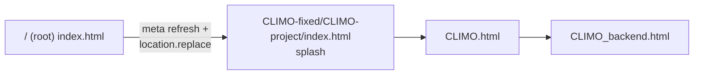
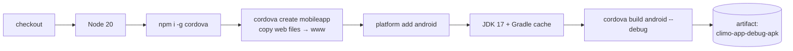

<p align="center"></p>

# 🚢 Deployment

CLIMO is **static files only**. Any host that serves HTML works, and the same folder becomes the Android app.

**Contents:** [Local](#-run-locally) · [GitHub Pages](#-github-pages) · [Other hosts](#-other-static-hosts) · [Android APK](#-android-apk) · [CI pipeline](#-ci-pipeline) · [Configuring routing](#-configuring-routing) · [Production checklist](#-production-checklist)

---

## 💻 Run locally

```bash
git clone https://github.com/chakrabortysohini2005-stack/Web-Mobile-Application-CLIMO.git
```

```bash
cd Web-Mobile-Application-CLIMO
```

Start any static server, for example:

```bash
python3 -m http.server 8080
```

```bash
npx serve .
```

Open <http://localhost:8080>. The root `index.html` redirects to `CLIMO-fixed/CLIMO-project/index.html`.

| Open via | Map + live data | GPS / Notifications |
|:--|:--:|:--:|
| `http://localhost` | ✅ | ✅ (localhost counts as a secure context) |
| `https://…` | ✅ | ✅ |
| `file://` (double-click) | ✅ | ❌ blocked by the browser |

---

## 🌍 GitHub Pages

The live demo is served from the **repository root** of the default branch:

**<https://chakrabortysohini2005-stack.github.io/Web-Mobile-Application-CLIMO/>**

To set it up in a fork:

1. **Settings → Pages → Build and deployment → Source: Deploy from a branch**
2. Branch: `main`, folder `/ (root)` → **Save**
3. Wait for the *pages-build-deployment* workflow, then open `https://<user>.github.io/<repo>/`



The interactive gallery is published with the site at `…/docs/gallery.html`.

---

## ☁ Other static hosts

| Host | Settings |
|:--|:--|
| **Netlify** | build command: *(none)* · publish directory: `.` |
| **Vercel** | framework: *Other* · output directory: `.` |
| **Cloudflare Pages** | build command: *(none)* · output: `/` |
| **Firebase Hosting** | `public: "."` in `firebase.json` |
| **nginx** | `root /srv/climo; index index.html;` |

To serve the app at the domain root without the redirect, point the host at `CLIMO-fixed/CLIMO-project/` instead.

---

## 🤖 Android APK

The web app is wrapped with **Apache Cordova**. Do it by hand like this:

```bash
npm install -g cordova
```

```bash
cd CLIMO-fixed/CLIMO-project
```

```bash
cordova create mobileapp com.climo.webapp "Climo App"
```

```bash
cp -R css js *.html mobileapp/www/
```

```bash
cd mobileapp && cordova platform add android
```

```bash
cordova build android --debug
```

The APK is written to `mobileapp/platforms/android/app/build/outputs/apk/debug/app-debug.apk`.

**Requirements:** Node 20, JDK 17, Android SDK + Gradle (Android Studio provides all three).

> 📲 Inside the WebView, **Export Report** opens the CSV as a data URI (`window.open`), because `<a download>` is ignored there. The app detects this from the `; wv)` user-agent token.

> 🔐 For GPS inside the APK, add the geolocation plugin and permissions:
>
> ```bash
> cordova plugin add cordova-plugin-geolocation
> ```

---

## 🔄 CI pipeline

`.github/workflows/android.yml` runs on every **push and pull request to `main`/`master`**:



**Download:** Actions → *Build CLIMO Web App to APK* → the latest run → **Artifacts → `climo-app-debug-apk`**.

> ⚠ The copy step (`cp -R * mobileapp/www/ || true`) also tries to copy `mobileapp` into itself. `|| true` hides that error. Listing the files explicitly (`css js *.html`) is cleaner.

### Signing a release build

```bash
cordova build android --release -- --keystore=climo.keystore --alias=climo --storePassword=$KS_PASS --password=$KEY_PASS
```

Store the keystore and passwords as **GitHub Actions secrets**, never in the repository.

---

## 🧭 Configuring routing

The weather-safe route uses **OpenRouteService**. Its key is in `ORS_CONFIG` near the top of the app IIFE in `js/app.js`:

```js
const ORS_CONFIG = {
  apiKey: "<your-openrouteservice-key>",
  base: "https://api.openrouteservice.org"
};
```

1. Sign up at <https://openrouteservice.org/dev/#/signup> (free tier).
2. Copy your key from the dashboard into `apiKey`.
3. For production, **proxy the request** instead of shipping the key. See [SECURITY.md](../SECURITY.md#-the-client-side-routing-key).

If no key is set, the route panel says: *"Add a free OpenRouteService key to ORS_CONFIG.apiKey to enable routing."*

---

## ✅ Production checklist

- [ ] Move the ORS key behind a serverless proxy, or restrict it by origin
- [ ] Add `LICENSE` and confirm attribution for OSM, Esri and Open-Meteo is visible (it already is in the map footer)
- [ ] Consider an Open-Meteo commercial plan if traffic is high (the free tier is for non-commercial use)
- [ ] Minify `app.js` and move `WEATHER_DATA` to a cached `.json` file
- [ ] Add a service worker for an offline shell
- [ ] Add `cordova-plugin-geolocation` and notification permissions for the APK
- [ ] Sign the release APK with a keystore kept in CI secrets
