

<h1 align="center">🖼 CLIMO Gallery</h1>

  Real, unedited screenshots of CLIMO running on live Open-Meteo data, captured with headless Chromium at 2× pixel density. 
  

  <a href="#-arrival">Arrival</a> ·
  <a href="#-the-observatory">Observatory</a> ·
  <a href="#-gis-analysis">GIS analysis</a> ·
  <a href="#-time--intelligence">Time & intelligence</a> ·
  <a href="#-alerts--inclusion">Alerts & inclusion</a> ·
  <a href="#-mobile">Mobile</a>

---

## ✦ Arrival

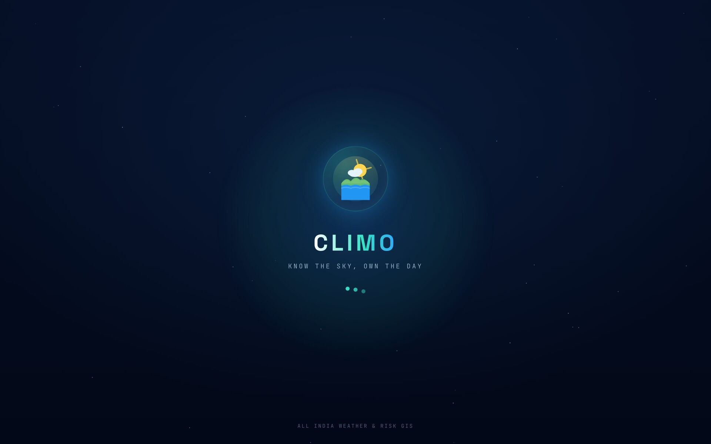

<b>Splash.</b> The CLIMO mark (sun, cloud, land and water) on a twinkling starfield. It moves on to the landing page after 2.6 s, or on tap.

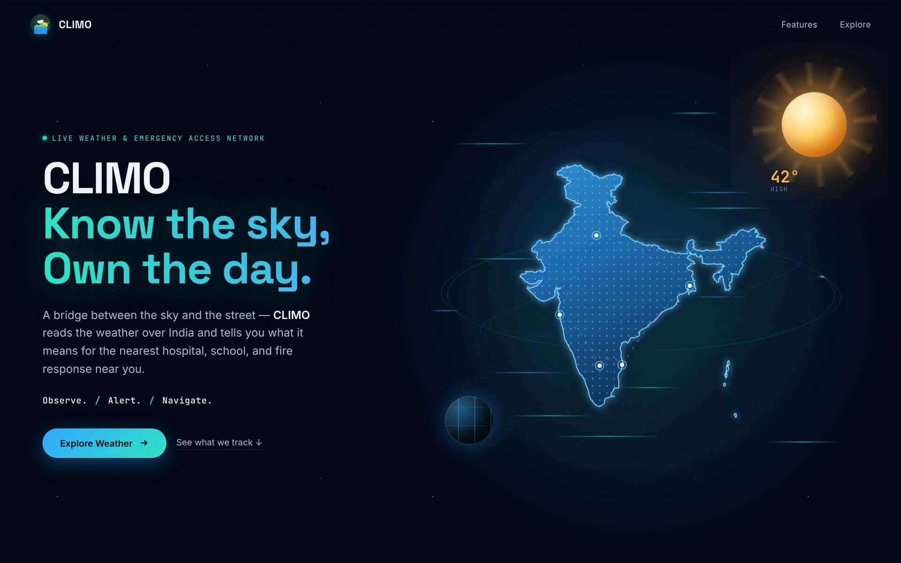

<b>Landing hero.</b> A glowing, dotted 3D India with animated data-flow arcs between five metros, orbit rings, a spinning mini-globe and a sun badge. The scene tilts toward your cursor.

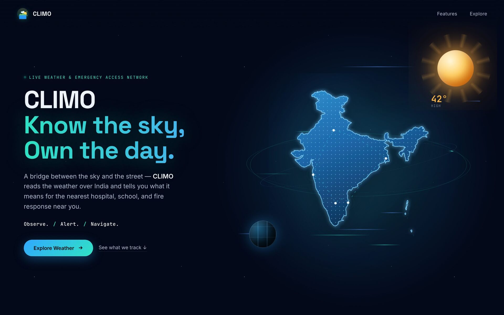

<b>What CLIMO tracks.</b> Temperature, rainfall, humidity, wind, heat maps, buffer zones and weather alerts.

---

## ✦ The observatory

<b>All-India observatory.</b> 90 stations, clustered by area and drawn with icons for AWS, radar, rain gauge and river gauge. The sidebar ranks the <b>top alerts across states</b> live.

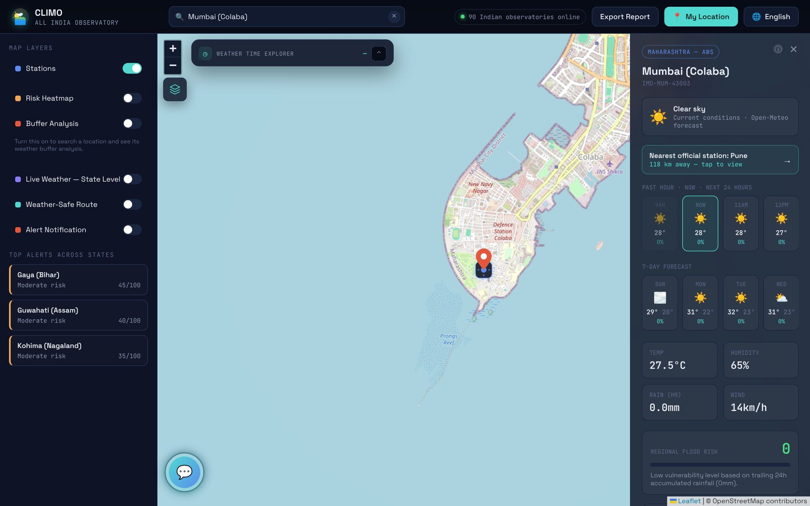

<b>Station drawer: Mumbai (Colaba).</b> Current conditions, nearest-station link, hourly strip, 7-day forecast, live readings and the regional flood-risk score.

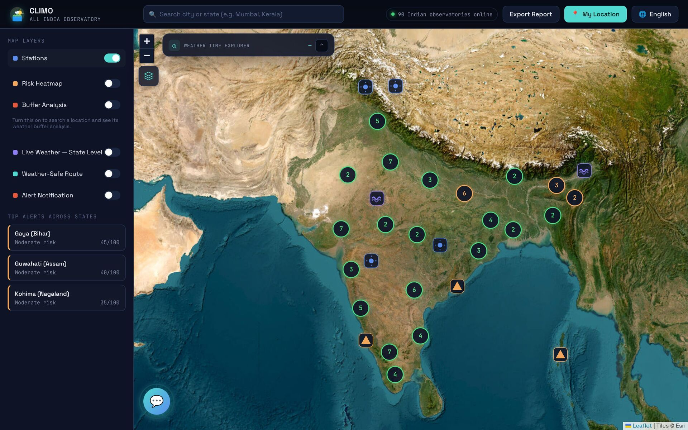

<b>Satellite basemap.</b> Esri World Imagery with the station network on top.

---

## ✦ GIS analysis

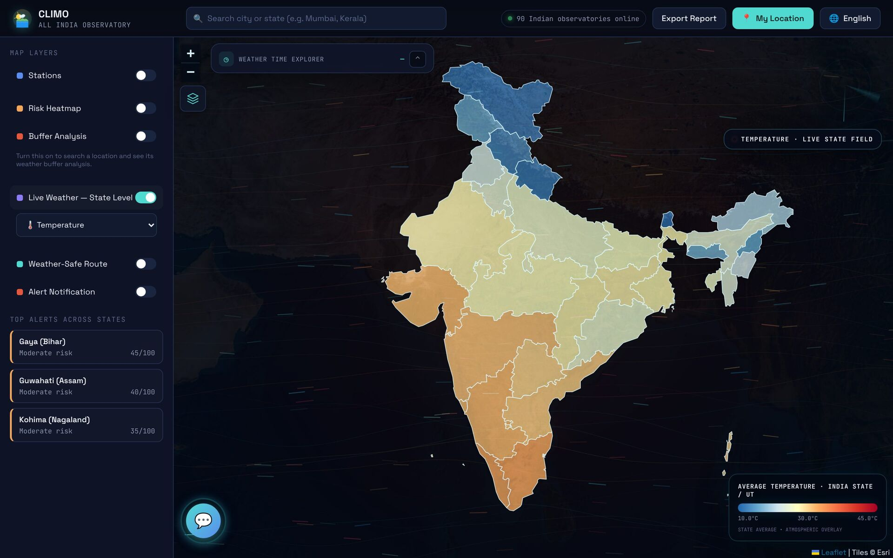

<b>Live state-level choropleth (temperature).</b> One batched API call covers every state centroid. A dark mask isolates India and canvas wind streaks drift across the scene.

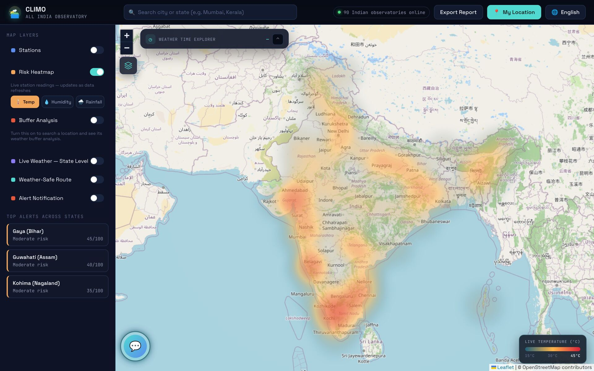

<b>Live heatmap.</b> Station temperatures blended into a continuous field with Leaflet.heat. Humidity and rainfall use the same control.

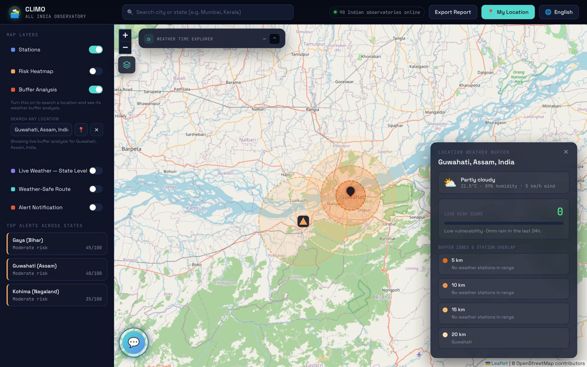

<b>Buffer analysis: Guwahati.</b> Concentric 5/10/15/20 km rings around a searched place, the risk-filtered 15 km station buffer, and an insights drawer listing stations in each ring.

---

## ✦ Time & intelligence

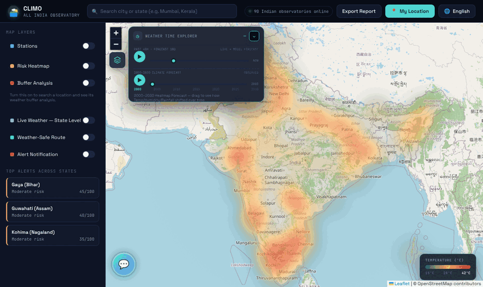

<b>Climate time machine (animated).</b> The year slider sweeps 2000 → 2030. Years up to 2025 are observed; the rest is an LSTM forecast.

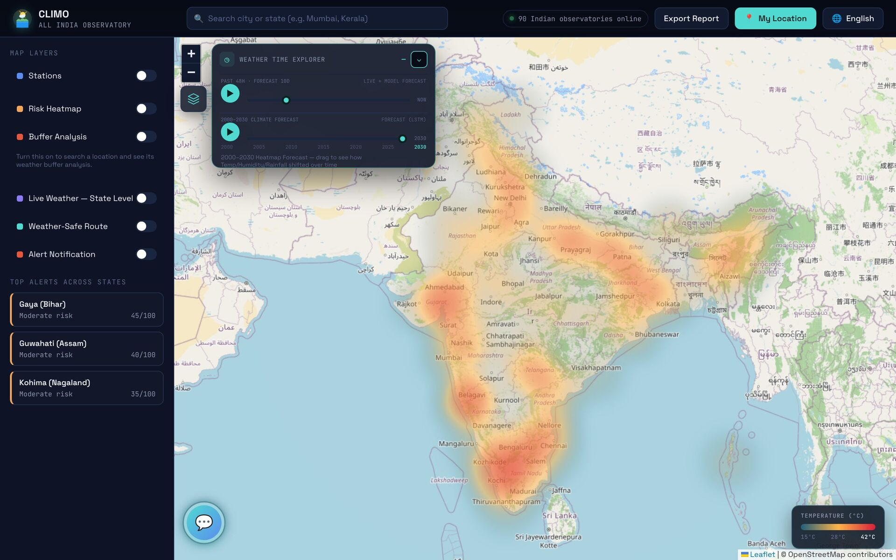

<b>Weather Time Explorer, expanded.</b> Top row: 48 h of history plus a 10-day forecast. Bottom row: the 2000–2030 climate slider, here at 2030 (<i>FORECAST (LSTM)</i>).

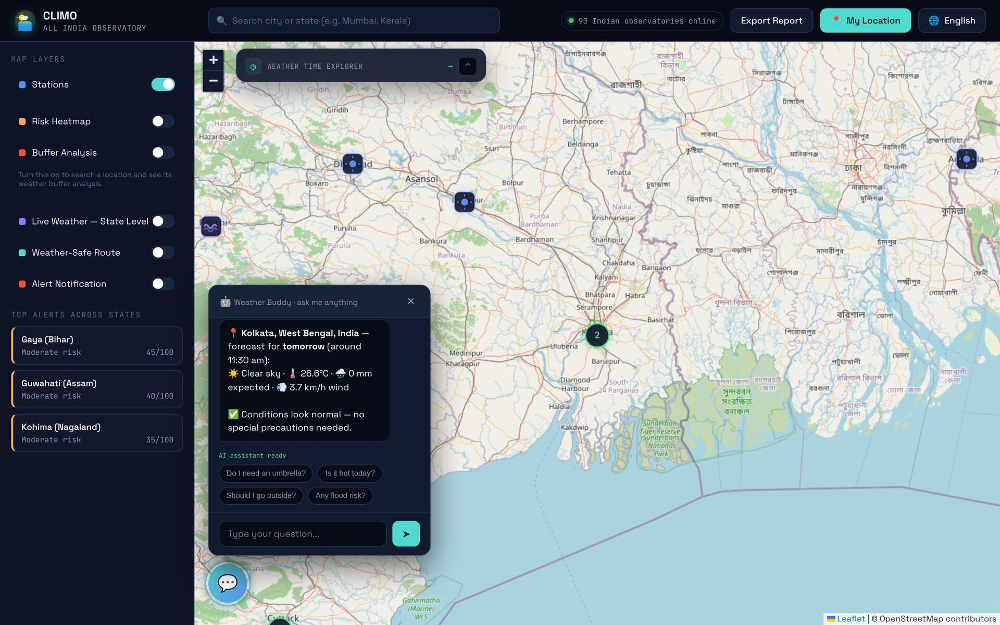

<b>Weather Buddy.</b> "Will it rain in Kolkata tomorrow?" It finds the place and the time, pulls the hourly forecast and gives practical advice. No LLM is involved.

---

## ✦ Alerts & inclusion

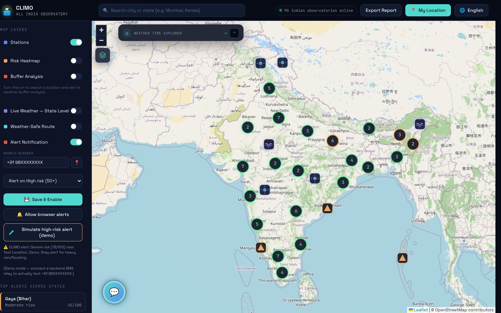

<b>Alert notification.</b> Watch your nearest station, choose a risk threshold, allow browser notifications, and test the flow with a simulated high-risk alert.

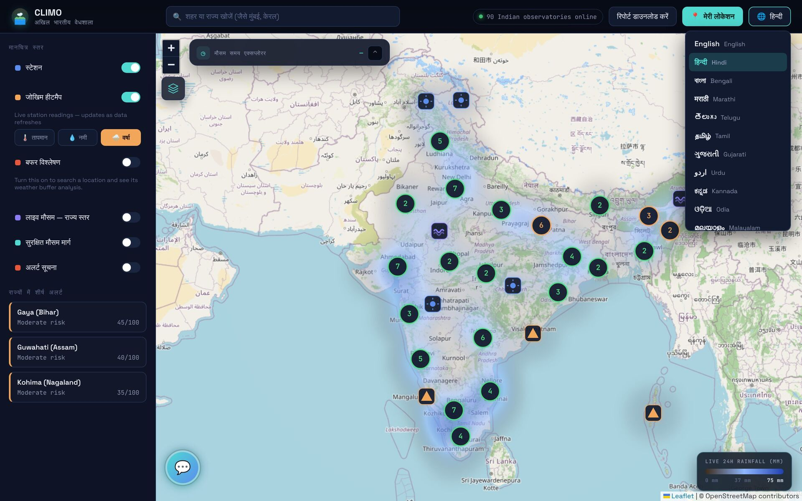

<b>16 Indian languages.</b> The interface switches live, shown here in Hindi with the rainfall heatmap and the language menu open.

---

## ✦ Mobile

<table>
  <tr>
    <td width="25%">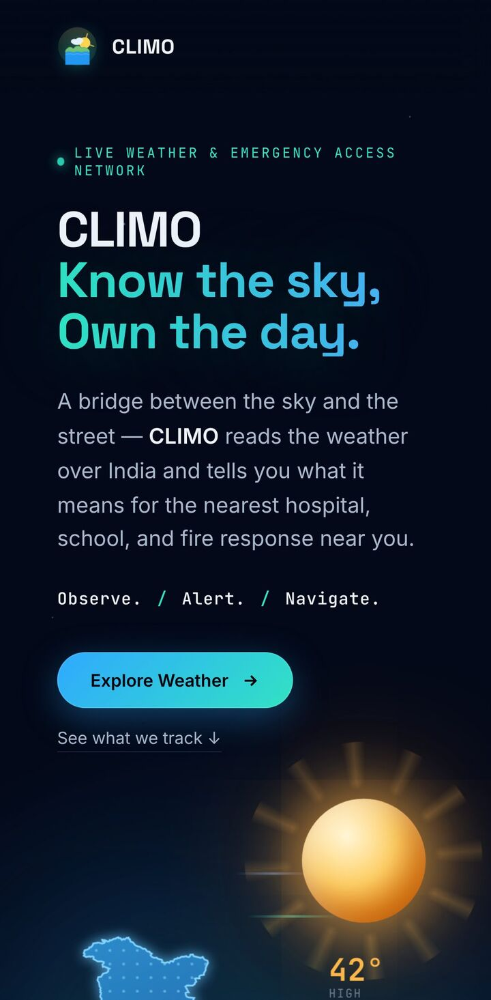</td>
    <td width="25%">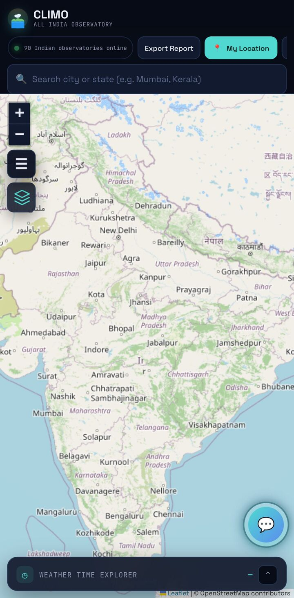</td>
    <td width="25%">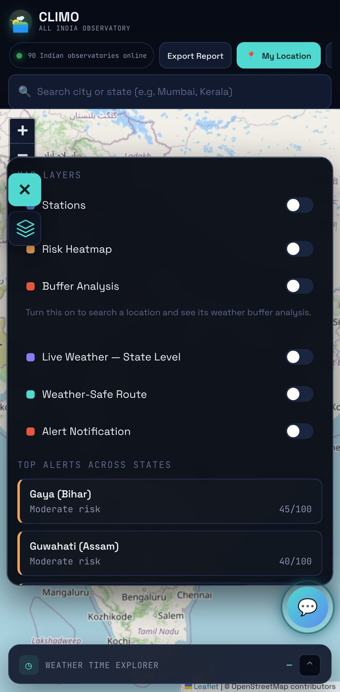</td>
    <td width="25%">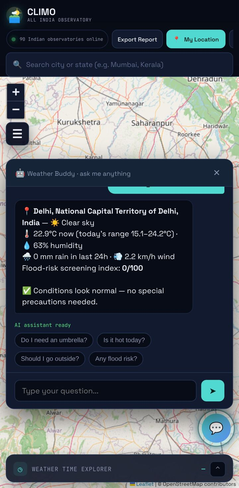</td>
  </tr>
  <tr>
    <td align="center"><b>Landing</b> hero reflows into one column</td>
    <td align="center"><b>Map</b> top bar wraps, time explorer docks at the bottom</td>
    <td align="center"><b>Layers drawer</b> sidebar slides in from ☰</td>
    <td align="center"><b>Weather Buddy</b> "Should I go outside in Delhi?"</td>
  </tr>
</table>

---

<b>🔁 How these screenshots were made (reproducible)</b>

The gallery was captured with Playwright and headless Chromium against a local `python3 -m http.server`:

- **Desktop:** 1440 × 900 viewport, `deviceScaleFactor: 2`. **Mobile:** Playwright's `Pixel 7` device profile.
- Open-Meteo responses were cached to disk and retried on HTTP 429, so all **90 stations** load in every shot. The data is the real live response from the capture date.
- Each scene runs in a fresh browser context: toggle a layer, wait for data, take the screenshot.
- The time-lapse GIF is 16 frames (2000 → 2030, every 2 years) assembled with ImageMagick.

The *Weather-Safe Route* panel is not pictured because the capture environment's network blocked `api.openrouteservice.org`. The algorithm is diagrammed in [ARCHITECTURE.md](ARCHITECTURE.md#-weather-safe-routing).

