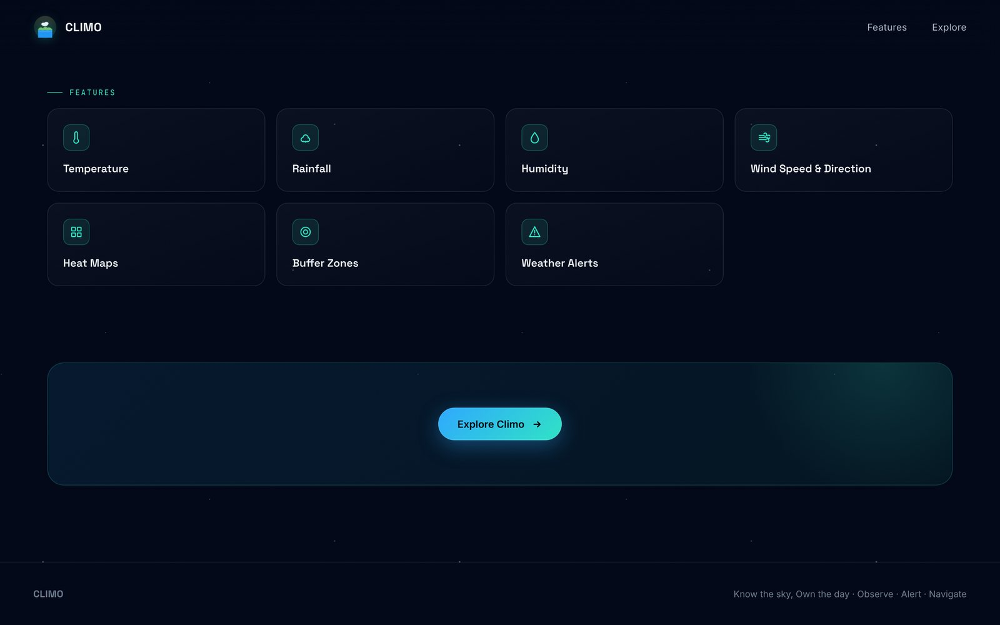
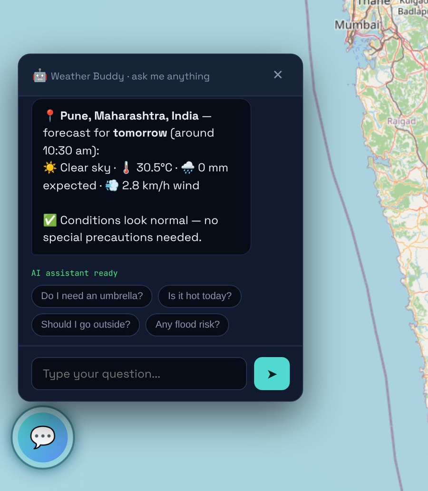
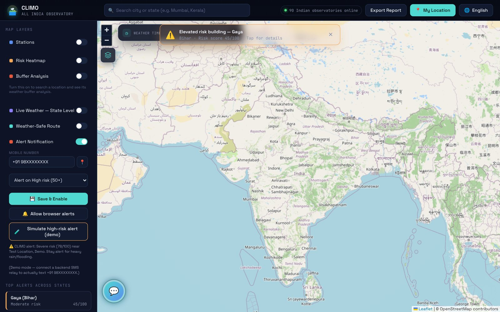
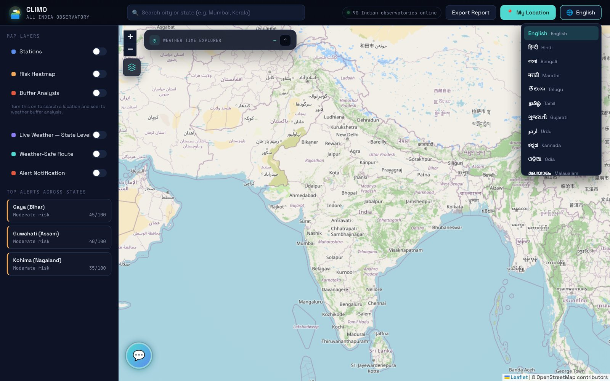
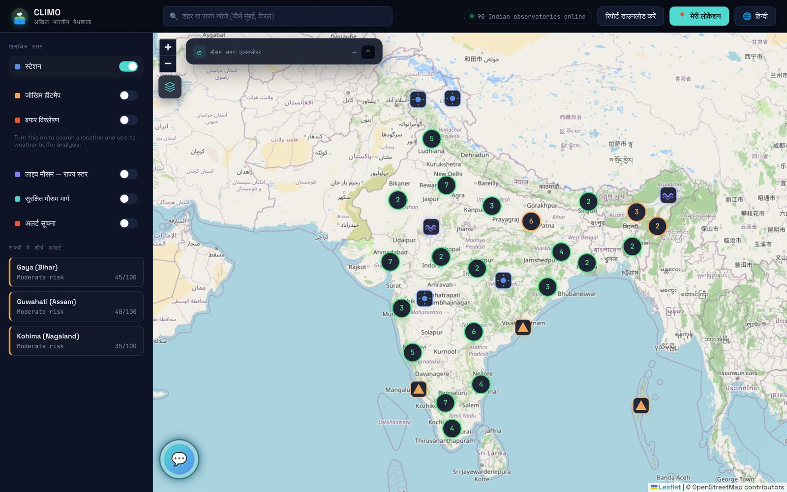

# 📸 CLIMO Gallery

> All captures come from the real app at **1440 × 900 (2× DPR)** and an **iPhone 14 Pro** viewport, running against **live Open-Meteo data** on capture day. Your numbers will differ, because the weather changes.
> Prefer clicking through? Open the **[lightbox gallery → `gallery.html`](gallery.html)**.

**Jump to:** [First impressions](#-first-impressions) · [The map](#-the-map) · [Weather layers](#-weather-layers) · [Spatial analysis](#-spatial-analysis) · [Intelligence and alerts](#-intelligence-and-alerts) · [Multilingual](#-multilingual) · [Mobile](#-mobile)

---

## ✨ First impressions

<table>
<tr>
<td width="50%"></td>
<td width="50%"></td>
</tr>
<tr>
<td><b>Splash</b>: a starfield, the sun, cloud, land and water logo, and a 2.6 s auto-advance. Tap anywhere to skip.</td>
<td><b>Landing hero</b>: a glowing, extruded 3D India with live city pins and flowing data lines. It tilts in parallax with your mouse.</td>
</tr>
<tr>
<td colspan="2"> <b>Feature grid</b>: temperature, rainfall, humidity, wind, heat maps, buffer zones and weather alerts. Each card tilts in 3D on hover.</td>
</tr>
</table>

---

## 🗺️ The map

<table>
<tr>
<td width="50%"></td>
<td width="50%"></td>
</tr>
<tr>
<td><b>Station network</b>: 90 stations, clustered and coloured by type (AWS, rain gauge, radar, river gauge). The <i>Top alerts</i> list ranks the riskiest stations.</td>
<td><b>Satellite basemap</b>: switch to Esri World Imagery from the layers button below the zoom control.</td>
</tr>
<tr>
<td></td>
<td align="center"></td>
</tr>
<tr>
<td><b>Search, fly and open.</b> Searching “Mumbai” zooms to Colaba and opens the station drawer.</td>
<td><b>Station drawer, close-up</b>: current conditions, the nearest other station (tap to route there), an hourly strip, a 7-day outlook, the four core readings and a regional flood-risk gauge.</td>
</tr>
</table>

---

## 🌦️ Weather layers

<table>
<tr>
<td width="50%"></td>
<td width="50%"></td>
</tr>
<tr>
<td><b>Live state temperature.</b> Every state and UT is coloured from one batched Open-Meteo call. Everything outside India is masked so the country stands out.</td>
<td><b>Live 24 h rainfall</b>, with the animated canvas atmosphere: falling rain particles, plus wind streaks and heat shimmer in the other modes.</td>
</tr>
<tr>
<td></td>
<td></td>
</tr>
<tr>
<td><b>Live heatmap</b> (Risk Heatmap → Temp). A Leaflet.heat surface built from each station's current reading.</td>
<td><b>Climate slider at 2030.</b> The Weather Time Explorer, expanded, drives the year-based heatmap (observed to 2025, LSTM forecast from 2026).</td>
</tr>
</table>

   
  <b>🎞️ The climate timelapse</b>, captured frame by frame from the real slider in 2-year steps.

---

## ⭕ Spatial analysis

<table>
<tr>
<td width="58%"></td>
<td width="42%"></td>
</tr>
<tr>
<td><b>Buffer analysis on any place.</b> Search “Kolkata” to draw 5 / 10 / 15 / 20 km rings, shaded from deep to light orange.</td>
<td><b>Location insights</b>: live conditions, a live risk score, and which stations fall inside each ring.</td>
</tr>
</table>

---

## 🤖 Intelligence and alerts

<table>
<tr>
<td width="50%"></td>
<td width="50%" align="center"></td>
</tr>
<tr>
<td><b>Weather Buddy</b> flies the map to the place you ask about…</td>
<td>…and answers in plain language with a recommendation. The question was <i>“weather in Pune tomorrow”</i>.</td>
</tr>
<tr>
<td colspan="2"> <b>Alert notification</b>: pick a threshold (Moderate 34+, High 50+, Severe 66+), allow browser alerts, and use <i>Simulate</i> to preview the banner and message. Real SMS needs a backend relay (see <a href="../SECURITY.md">SECURITY.md</a>).</td>
</tr>
</table>

---

## 🗣️ Multilingual

<table>
<tr>
<td width="50%"></td>
<td width="50%"></td>
</tr>
<tr>
<td><b>16 languages</b>, each shown in its own script.</td>
<td><b>हिन्दी.</b> Panels, buttons and placeholders switch instantly, and the choice is remembered.</td>
</tr>
</table>

---

## 📱 Mobile

  
  &nbsp;
  
  &nbsp;
  

<b>Landing → map → layers drawer.</b> The ☰ button opens the sidebar as a sheet, and tapping the map closes it. The same build runs in the Cordova Android app.

---

Want to regenerate these? Serve the repo locally and drive the pages with Playwright. Each section above maps to a sidebar toggle described in the <a href="USER_GUIDE.md">User Guide</a>.
