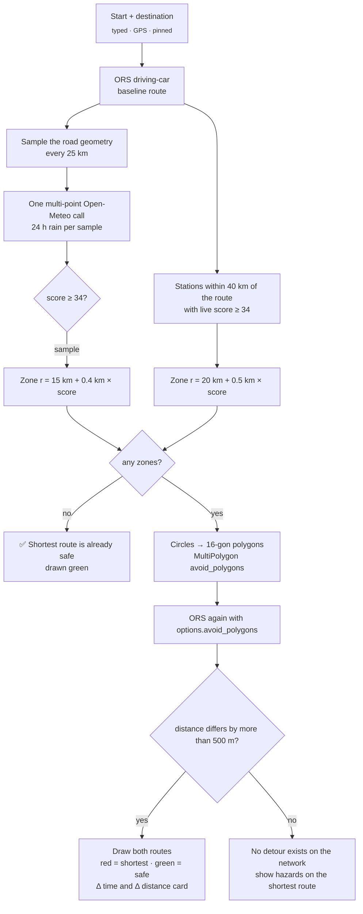

# 🧮 CLIMO Methodology

> How CLIMO turns raw weather into risk scores, buffers, safer routes and a 30-year climate view, and where its limits are. Function names refer to `CLIMO-fixed/CLIMO-project/js/app.js`.

**Contents:** [Station network](#1-station-network) · [Live station score](#2-live-station-score) · [Multi-factor index](#3-multi-factor-screening-index-computerisk) · [Risk bands](#4-risk-bands-and-alerting) · [Buffer analysis](#5-buffer-analysis) · [Weather-safe routing](#6-weather-safe-routing) · [State choropleth](#7-state-level-choropleth) · [Climate dataset](#8-climate-dataset-20002030) · [Weather Buddy](#9-weather-buddy-logic) · [Limitations](#10-limitations-and-known-issues)

---

## 1. Station network

`INDIA_STATIONS` holds **90 points across 33 states and UTs**, with IDs in the IMD/WMO style (for example `IMD-DEL-42182`, New Delhi Safdarjung).

| Type | n | Role in the UI |
|---|---|---|
| AWS | 35 | General observatories |
| Rain gauge | 24 | Rain-focused points |
| River gauge | 19 | Flood-prone basins (Patna, Ranchi, …) |
| Radar | 12 | Regional coverage hubs |

> Station **metadata** (name, type, location) identifies each point. The **readings** at every point come from Open-Meteo's model blend for those coordinates, not from the physical instrument's feed.

For each station `fetchStationData()` requests:

```
current : temperature_2m, relative_humidity_2m, precipitation, wind_speed_10m, weathercode
hourly  : temperature_2m, precipitation, weathercode, precipitation_probability
daily   : weathercode, temperature_2m_max/min, precipitation_sum, precipitation_probability_max
window  : past_days=2, forecast_days=10   (≈ 288 hourly steps)   timezone=Asia/Kolkata
```

---

## 2. Live station score

This score drives **marker colour and halo radius, Top alerts, banners, station buffers, route avoid-zones and the location alert**. `updateAtTimeIndex(t)` recomputes it for every station whenever the timeline moves, and every 5 minutes for “now”.

$$
\text{live}(t) = \min\left(100,\ \operatorname{round}\left(\frac{\sum_{h=t-23}^{t} P_h}{75\ \text{mm}} \times 100\right)\right)
$$

- $P_h$ is the hourly precipitation at hour $h$. The window is the **24 hours ending at the selected hour**.
- **75 mm in 24 h maps to 100.** For context, IMD calls 64.5–115.5 mm in 24 h *heavy rainfall*, so the scale saturates inside that band.
- The marker halo radius is `20 km + score × 0.5 km`.

---

## 3. Multi-factor screening index: `computeRisk()`

This index is used for **ad-hoc locations**: searched places, map clicks, *My Location*, buffer-location insights and Weather Buddy. It is also the fallback before a live score exists.

<p align="center"></p>

| Component | Weight | Normaliser (capped at 1) | Rationale |
|---|---:|---|---|
| 24 h rainfall | **45** | ÷ 75 mm | Antecedent soil saturation and drainage load |
| 6 h rainfall | **25** | ÷ 35 mm | Flash-flood and urban waterlogging pulse |
| Precipitation probability (daily max, *intended* as today) | **15** | ÷ 80 % | Rain that is likely but has not fallen yet |
| Current precipitation intensity | **10** | ÷ 8 mm/h | Is it pouring right now? |
| Storm signal (WMO code) | **5** | 95/96/99 → 1 · 80–82 → 0.5 · else 0 | Convective thunderstorms and showers |

$$
S = \operatorname{clamp}_{0}^{100}\Big(\operatorname{round}\big(45\,r_{24} + 25\,r_{6} + 10\,r_{now} + 15\,p + 5\,s\big)\Big)
$$

The function also returns `rainfall24h`, `rainfall6h`, `rainProbability` and `currentRain` for display.

---

## 4. Risk bands and alerting

| Band | Score | Hex | Triggers |
|---|---|---|---|
| Low | 0–33 | `#4ADE80` | A score of **20 or more** still lists the station in *Top alerts* |
| Moderate | 34–65 | `#F2A65A` | **Banner** at the “now” index · **15 km buffer** · **avoid-zone** when routing |
| High | 66–100 | `#E4573D` | The same, in red |

`RISK_THRESHOLDS = { moderate: 34, high: 66 }` is the single source of truth for both colours and avoid-zone cut-offs, so a dot's colour always matches whether it gets a zone.

**Banner pipeline:** `queueBanner()` → one banner at a time → `maybeNativeNotify()` if permission was granted. A per-session `alreadyBannered` set stops repeats and is cleared every 45 minutes.

**Location alert:** the user picks 34, 50 or 66. `checkMyLocationAlert()` fires once when the watched station's live score crosses the threshold, and re-arms after it drops back below.

---

## 5. Buffer analysis

### Station buffers
- A geodesic `L.circle` of **15 km** (`bufferRadiusKm`) around every station with a live score of 34 or more. Kanpur and Lucknow are deliberately excluded (`BUFFER_EXCLUDED_NAMES`).
- Clicking a buffer shows its area $A = \pi r^2 \approx 707\ \text{km}^2$, the risk band, and the number of other stations inside it, counted with the **haversine** distance:

$$
d = 2R \arcsin\sqrt{\sin^2\tfrac{\Delta\varphi}{2} + \cos\varphi_1\cos\varphi_2\sin^2\tfrac{\Delta\lambda}{2}},\quad R = 6371\ \text{km}
$$

### Custom-location rings
- Rings of **20, 15, 10 and 5 km** are drawn from largest to smallest, so the smaller ones sit on top. Their opacity rises from 0.14 to 0.34 and their colour deepens from `#FFDDB3` to `#E4671E`.
- CLIMO fetches live weather for the exact point, scores it with `computeRisk()`, and lists the stations inside each ring.

---

## 6. Weather-safe routing



Key details:
- **Sample score:** `min(100, round(Σ24h / 75 mm × 100))`, the same scale as the live station score.
- **Corridor filter:** a high-risk station only counts if it lies within **40 km** of some sample point. Without this, a storm on the other side of India would distort the request.
- **Circle → polygon:** `circleToRing()` builds 16 vertices using 110.574 km per degree of latitude and 111.320·cos φ km per degree of longitude.
- **No-op detection:** ORS silently returns the same path when no detour exists. CLIMO treats a change under 500 m as “no alternative” rather than claiming a safe route.

---

## 7. State-level choropleth

1. Load the state and UT polygons from `geojson-india@0.0.2`, and compute each polygon's centre.
2. Make **one** Open-Meteo request with comma-separated latitudes and longitudes for every centre. This avoids a burst of 429 errors.
3. Store `temperature`, `humidity`, `wind`, `rainfall24h` (Σ of the last 24 hourly values), `feels`, `windDir`, `tmax` and `tmin` per state.
4. Colour each state by linear interpolation between ramp stops:

| Parameter | Domain | Ramp |
|---|---|---|
| Temperature | 10–45 °C | blue → yellow → red (8 stops) |
| Rainfall (24 h) | 0–75 mm | deep navy → sky → rose |
| Humidity | 20–100 % | sand → teal → indigo |
| Wind | 0–60 km/h | pale → deep green |

5. If the live call fails, `FALLBACK_STATE_VALUES` supplies deterministic, clearly labelled estimates.
6. An inverse mask (the world minus India) dims neighbouring countries, and the canvas atmosphere animates the active parameter.

---

## 8. Climate dataset (2000–2030)

`WEATHER_DATA`, the *India Climate Pulse* table, is embedded in `app.js` and indexed into `CLIMATE_BY_STATION_YEAR`.

| Property | Value |
|---|---|
| Rows | **2,790** = 90 stations × 31 years |
| Observed | 2000–2025 · 2,340 rows |
| Forecast (LSTM) | 2026–2030 · 450 rows |
| Fields | `Station_ID, Station_Name, Latitude, Longitude, Year, Temperature_C, Rainfall_mm, Humidity_percent, Heat_Stress_Index_C, Source` |
| Join key | `Station_ID` ↔ `INDIA_STATIONS.id` |

All-station means from the table:

| Year | Mean temp (°C) | Mean annual rain (mm) | Mean RH (%) | Mean heat-stress (°C) | Source |
|---|---:|---:|---:|---:|---|
| 2000 | 29.94 | 2,031 | 67.2 | 34.80 | Observed |
| 2010 | 30.09 | 2,072 | 67.2 | 35.21 | Observed |
| 2020 | 30.28 | 2,051 | 66.6 | 35.58 | Observed |
| 2025 | 30.43 | 2,105 | 66.6 | 35.91 | Observed |
| 2030 | 30.38 | 2,028 | 67.0 | 35.72 | LSTM |

That is a **+0.49 °C** rise in mean station temperature and **+1.1 °C** in the heat-stress index from 2000 to 2025.

Heatmap scaling for the year view: temperature 15–42 °C, humidity 30–90 %, rainfall 200–3,200 mm. The live view uses 15–45 °C, 20–100 % and 0–75 mm (24 h), because the live rainfall is a 24 h total rather than an annual one.

> The LSTM model and its training pipeline are **not** part of this repository. Only its 2026–2030 outputs are embedded.

---

## 9. Weather Buddy logic

The assistant is fully local and has no LLM. `executeGISCommand()` routes each question by regex intent:

| Intent | Pattern examples | Action |
|---|---|---|
| Greeting / help | `hi`, `help`, `what can you do` | A static reply |
| Risk ranking | `highest risk`, `flood risk`, `danger zones` | Sort stations by live score |
| My location | `near me`, `my location` | Geolocation → `fetchPlaceWeather()` → Nominatim reverse |
| Place weather | `weather in <place>` | Geocode → fly the map → `formatPlaceWeather()` |
| Time offset | `in 2 hours`, `next hour`, `tonight`, `tomorrow` | `parseTimeOffset()` → `formatHourlyAnswer()` at that index |

`extractLocationFromQuery()` strips a stop-word list to isolate the place name. `buildSuggestions()` turns the numbers into advice:

| Condition | Tip |
|---|---|
| Rain score of 66 or more | 🚨 Avoid low-lying areas and underpasses |
| Raining now, or score of 35 or more | ☔ Take an umbrella |
| 12 °C or below / 20 °C or below | 🧥 Warm jacket / light sweater |
| 32 °C or above / 38 °C or above | 🌞 Breathable clothing / 🥵 hydrate |
| Wind of 35 km/h or more | 💨 Secure loose items |

---

## 10. Limitations and known issues

| # | Limitation | Impact | Suggested fix |
|---|---|---|---|
| 1 | **The 24 h window in `computeRisk()` is the tail of the hourly array.** The station series runs from 2 days ago to 10 days ahead, so `slice(-24)` reads the **last forecast day**, not the trailing 24 h. The 6 h term has the same problem. Similarly, `daily.precipitation_probability_max[0]` is the day **two days ago** (because of `past_days=2`), not today. | The multi-factor index for searched places can reflect rain about 10 days out. The live station score (section 2) is **not** affected. | Slice up to the current-hour index, as `updateAtTimeIndex()` already does. |
| 2 | **Route samples use UTC “today”.** `past_days=1&forecast_days=1&timezone=UTC` and then `slice(-24)` reads the full current UTC day, which includes future hours. | Mixes observed and forecast rain along the route | Request `timezone=Asia/Kolkata` and slice around the current hour |
| 3 | Data is fetched **once** at boot | A tab left open for a long time drifts toward forecast values | Re-fetch on the 5-minute tick, or with a staleness check |
| 4 | Model data, not gauges | Values come from Open-Meteo's model blend, not IMD instruments | Integrate IMD AWS feeds where licensing allows |
| 5 | Rain-only hazard | No river stage, DEM, soil or drainage data | Add slope, flow accumulation or river-gauge feeds |
| 6 | Feedback is not shared | Posts live only in the current page | A small backend or a realtime store |
| 7 | The ORS key is in client JS | It can be copied and its quota used up | Use a serverless proxy (see [SECURITY.md](../SECURITY.md)) |

> ⚠️ **Disclaimer.** CLIMO is a research and educational tool. Its scores are screening indicators, not official forecasts or warnings. Follow **IMD** and **NDMA** advisories.
