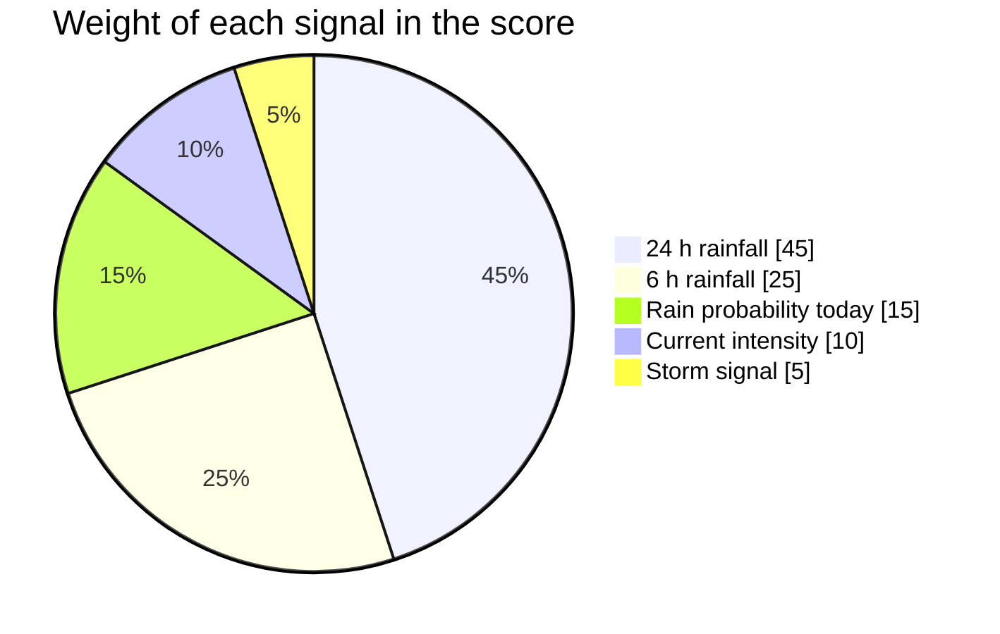

# 🌧 Risk model & GIS methodology

> **Read this first:** CLIMO's flood-risk index is an **operational screening index** built from live weather variables. It is **not** a hydrodynamic or hydrological flood model. It does not know about terrain, drainage, soil moisture or river stage. Use it to see *where to look*, not to make evacuation decisions.

**Contents:** [Flood-risk index](#1-flood-risk-index) · [Risk bands](#2-risk-bands) · [Worked example](#3-worked-example) · [Route corridor scoring](#4-route-corridor-scoring) · [Avoid zones](#5-avoid-zones) · [Buffer analysis](#6-buffer-analysis) · [Nearest station](#7-nearest-station) · [Report verification](#8-citizen-report-verification) · [State choropleth](#9-state-choropleth) · [Limitations](#10-limitations)

---

## 1. Flood-risk index

Source: `computeRisk(hourlyRain, current, daily)` in `js/app.js`.

**Inputs** (from Open-Meteo, `timezone=Asia/Kolkata`, `past_days=2`):

| Symbol | Meaning | Source field |
|:--|:--|:--|
| $R_{24}$ | sum of the last 24 hourly precipitation values (mm) | `hourly.precipitation` |
| $R_{6}$ | sum of the last 6 hourly values (mm) | `hourly.precipitation` |
| $P_{now}$ | current precipitation (mm) | `current.precipitation` |
| $p$ | today's max precipitation probability (%) | `daily.precipitation_probability_max[0]` |
| $w$ | WMO weather code | `current.weathercode` |

**Normalisation** (each term is clipped to the range 0–1):

$$
\hat R_{24}=\min\!\left(\tfrac{R_{24}}{75},1\right),\quad
\hat R_{6}=\min\!\left(\tfrac{R_{6}}{35},1\right),\quad
\hat P=\min\!\left(\tfrac{P_{now}}{8},1\right),\quad
\hat p=\min\!\left(\tfrac{p}{80},1\right)
$$

$$
S(w)=\begin{cases}1 & w\in\{95,96,99\}\ \text{(thunderstorm)}\\0.5 & w\in\{80,81,82\}\ \text{(rain showers)}\\0&\text{otherwise}\end{cases}
$$

**Score:**

$$
\boxed{\;\text{score}=\operatorname{round}\big(45\hat R_{24}+25\hat R_{6}+10\hat P+15\hat p+5S(w)\big)\in[0,100]\;}
$$

**Why these choices?**

- **Accumulation dominates (70 %).** Waterlogging comes from rain that has already fallen. A 75 mm/24 h saturation point sits in IMD's *heavy rainfall* range (64.5–115.5 mm/day), so "very wet day" means full marks.
- **Recency (25 %).** A 35 mm burst in 6 h stresses urban drainage even when the 24 h total looks moderate.
- **Look-ahead (15 %).** Probability adds forward-looking risk on a day that is still dry.
- **Convective kicker (5 %).** Thunderstorm codes add a small boost for flash-flood potential.

When the user scrubs the Weather Time Explorer, the score is **recomputed at the selected hour** (`updateAtTimeIndex`) and stored as `station._liveScore`. Alerts always use the true "now" index (`nowIndexGlobal`), not the scrubber position.

---

## 2. Risk bands

Defined once as `RISK_THRESHOLDS = { moderate: 34, high: 66 }`:

| Band | Range | Colour | Behaviour |
|:--|:--:|:--:|:--|
| 🟢 Low | 0–33 | `#4ADE80` | marker only |
| 🟠 Moderate | 34–65 | `#F2A65A` | appears in **Top Alerts**, gets a **15 km buffer**, becomes a **route avoid-zone**, triggers an "Elevated risk" banner |
| 🔴 High | 66–100 | `#E4573D` | all of the above plus a stronger banner and a native notification |

> The code comment explains why there is a single constant: an earlier version used a separate cutoff for avoid-zones, so some orange (Moderate) dots on a route had no avoid circle. Every consumer now reads `RISK_THRESHOLDS.moderate`.

---

## 3. Worked example

A coastal station during a monsoon spell:

| Signal | Value | Normalised | × weight | Points |
|:--|--:|--:|--:|--:|
| $R_{24}$ | 48 mm | 0.640 | 45 | 28.8 |
| $R_{6}$ | 21 mm | 0.600 | 25 | 15.0 |
| $P_{now}$ | 3.2 mm | 0.400 | 10 | 4.0 |
| $p$ | 90 % | 1.000 | 15 | 15.0 |
| $w$ | 81 (moderate showers) | 0.5 | 5 | 2.5 |
| | | | **score** | **65 → 🟠 Moderate** (one point below High) |

---

## 4. Route corridor scoring

Source: `sampleRouteEvery()` and `fetchRouteWeatherRisk()`.

1. Walk the ORS road geometry, adding up Haversine distance, and drop a sample every **25 km**. The start point is always kept.
2. If there are more than **40** samples, thin them evenly so they fit in one request.
3. Send **one batched** Open-Meteo request with comma-separated lat/lon lists (`hourly=precipitation&past_days=1`).
4. Score each sample with a rain-only index:

$$
\text{score}_{sample}=\min\!\left(\operatorname{round}\!\left(\tfrac{R_{24}}{75}\cdot100\right),100\right)
$$

This deliberately matches the main model's dominant term instead of copying the full model, because sending all five inputs for 40 points would be too heavy.

---

## 5. Avoid zones

Source: `buildStationAvoidZones()`, `circleToRing()` and `fetchWeatherSafeRoute()`.

| Zone source | Included when | Radius |
|:--|:--|:--|
| Station | score ≥ 34 **and** within **40 km** (`CORRIDOR_KM`) of any route sample | $20\,\text{km}+0.5\,\text{km}\times\text{score}$ |
| Route sample | sample score ≥ 34 | $15\,\text{km}+0.4\,\text{km}\times\text{score}$ |

Each circle becomes a closed **16-vertex polygon** (`circleToRing`). It uses a local **equirectangular approximation**: 110.574 km per degree of latitude, and 111.320 · cos φ km per degree of longitude. For vertex angle θ:

$$
\Delta\varphi=\frac{r\sin\theta}{110.574},\qquad
\Delta\lambda=\frac{r\cos\theta}{111.320\,\cos\varphi}
$$

At radii of 20–70 km this is accurate to well under 1 % across India's latitudes (8°–35° N).

All rings are sent to ORS as one `MultiPolygon` in `options.avoid_polygons`. ORS quietly returns the same path when no detour exists, so a candidate only counts as a **different safe route** if its length differs by **more than 500 m**.

---

## 6. Buffer analysis

**Station buffers** (`drawStationBuffers`): when the layer is on, every station with score ≥ 34 gets a dashed **15 km** circle in its risk colour. Clicking it opens an insights card that shows:

- buffer area: $A=\pi r^2$ (≈ 707 km² at 15 km)
- **overlapping stations**: how many other stations fall within $r$ (Haversine)
- live readings and the risk explanation

Kanpur and Lucknow are excluded on purpose (`BUFFER_EXCLUDED_NAMES`).

**Location buffers** (`drawCustomLocationBuffers`): search any place, or use GPS, to draw **5 / 10 / 15 / 20 km** concentric rings. The live weather and risk score are fetched for that exact point, and the drawer lists which stations fall inside each ring.

---

## 7. Nearest station

`findNearestStation(lat, lon, excludeId)` is a brute-force nearest-neighbour search using the **Haversine** great-circle distance ($R_\oplus$ = 6371 km):

$$
d=2R_\oplus\arcsin\sqrt{\sin^2\tfrac{\Delta\varphi}{2}+\cos\varphi_1\cos\varphi_2\sin^2\tfrac{\Delta\lambda}{2}}
$$

With n = 90 this takes microseconds, so no spatial index is needed. The result is cached on the station object.

---

## 8. Citizen report verification

`verifyReport(station, cond)` cross-checks an on-the-ground report against station rainfall:

| Report | Verified if | Confidence |
|:--|:--|:--|
| Flooding | $R_{24}\ge 40$ mm | $\min(100, R_{24}/60\cdot100)$ |
| Heavy rain | $R_{24}\ge 15$ mm **or** $P_{now}\ge 2$ mm | $\min(100,\max(R_{24},10P_{now})/30\cdot100)$ |
| Dry | $R_{24}<5$ **and** $P_{now}<0.5$ | $100-R_{24}/5\cdot100$ |

> ⚠️ **Status:** the function exists but **is not called** in the current build. The "Local feedback" box in the station drawer posts to an on-device list without verifying it. Connecting the two is on the [roadmap](../README.md#-roadmap).

---

## 9. State choropleth

- Polygons: `geojson-india@0.0.2`. State names are normalised so they match the station registry.
- Values: **one** batched Open-Meteo request at each polygon's **centroid**. If that fails, the average of the stations in that state is used.
- Colour: `interpolateColor(value, stops)` does piecewise-linear RGB interpolation over diverging ramps:

| Parameter | Domain | Ramp |
|:--|:--|:--|
| Temperature | 10–45 °C | `#2166ac → #ffffbf → #a50026` (RdYlBu, reversed) |
| Rainfall (24 h) | 0–75 mm | deep navy → sky → coral |
| Humidity | % | cyan → violet |
| Wind | km/h | ice → mint → lime |

- Cartography: a dark mask covers everything **outside** India so the subject stands out. A canvas particle field (wind streaks, rain, humidity haze, heat shimmer) is drawn to match the chosen parameter.

> 🧭 **GIS note:** a centroid value standing in for a whole state is a strong simplification for large or varied states such as Rajasthan, Maharashtra or Ladakh. Zonal statistics over a gridded product would be the next step.

---

## 10. Limitations

| Limitation | Effect | Possible improvement |
|:--|:--|:--|
| Weather-only index | ignores terrain, drainage, soil, rivers | add DEM/HAND, land-use imperviousness, river gauges (CWC) |
| Model data, not observations | Open-Meteo is NWP-based, so station "readings" are model values at those coordinates | blend in IMD AWS observations where available |
| Fixed saturation points | 75 mm/24 h may be routine in Mumbai or Cherrapunji but extreme in Leh | normalise by local climatology (percentiles from `WEATHER_DATA`) |
| Centroid sampling per state | hides variation inside a state | grid sampling + zonal mean |
| Rain-only route score | under-weights storms and wind on highways | add gusts and weather codes to the batched call |
| Brute-force nearest neighbour | fine at 90 points | k-d tree or geohash beyond about 10k points |
