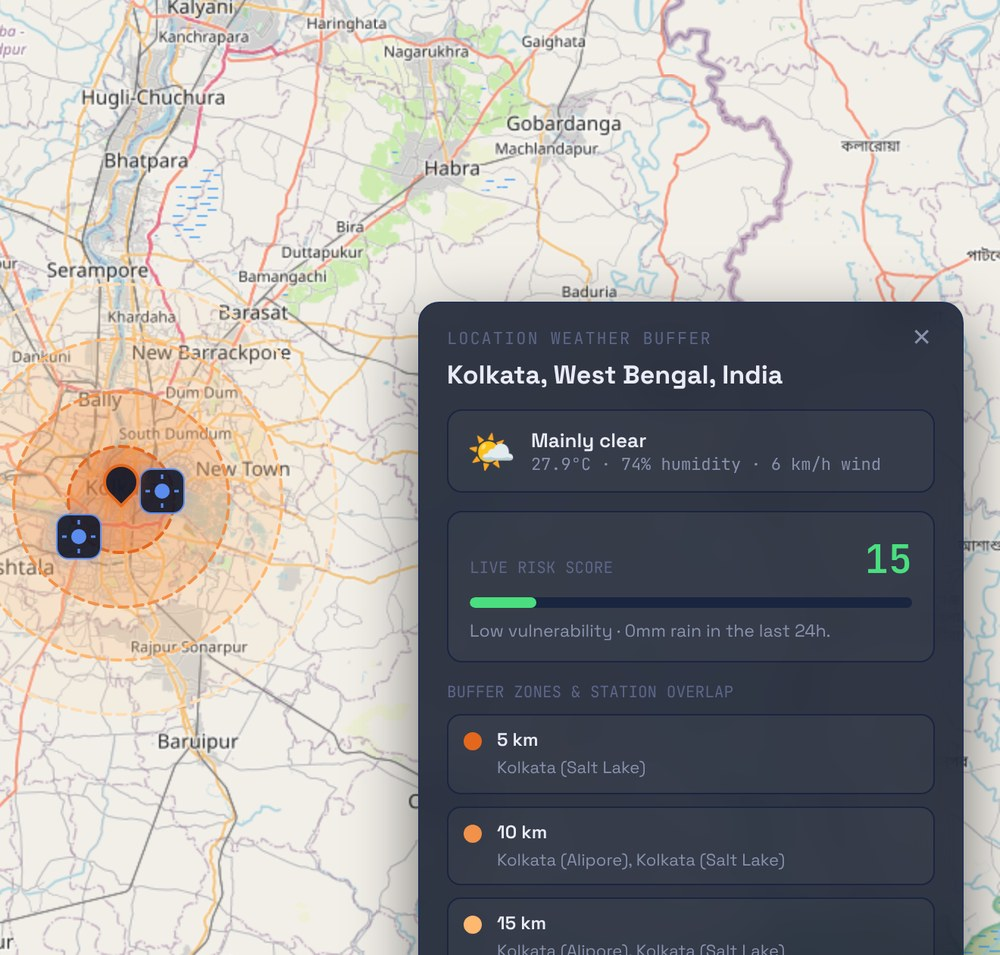
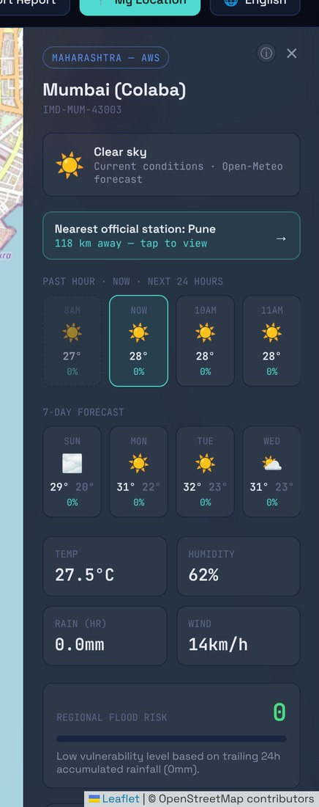
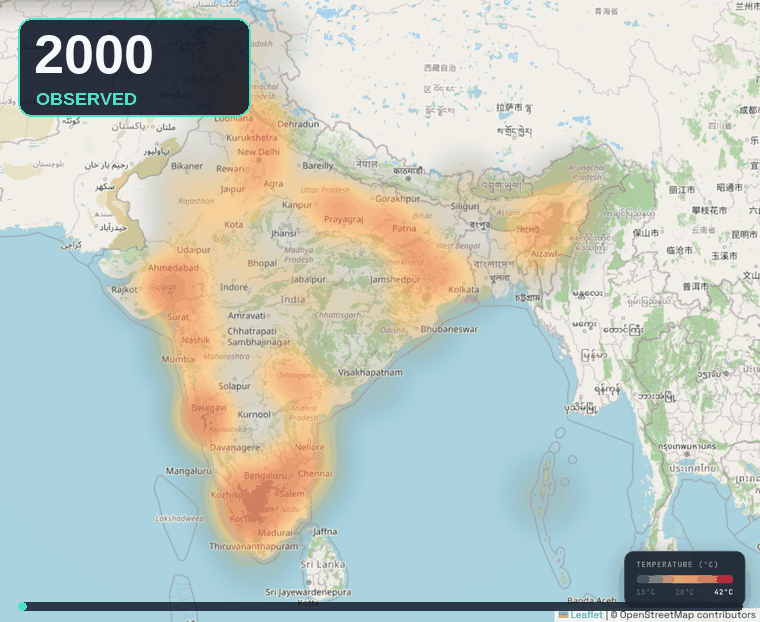
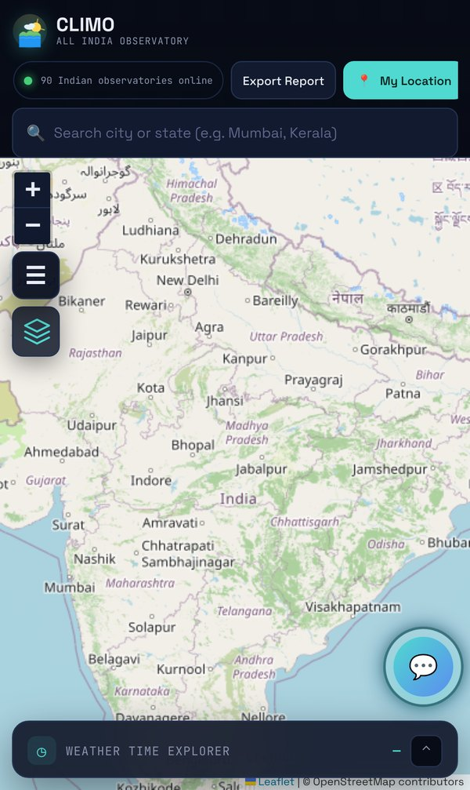
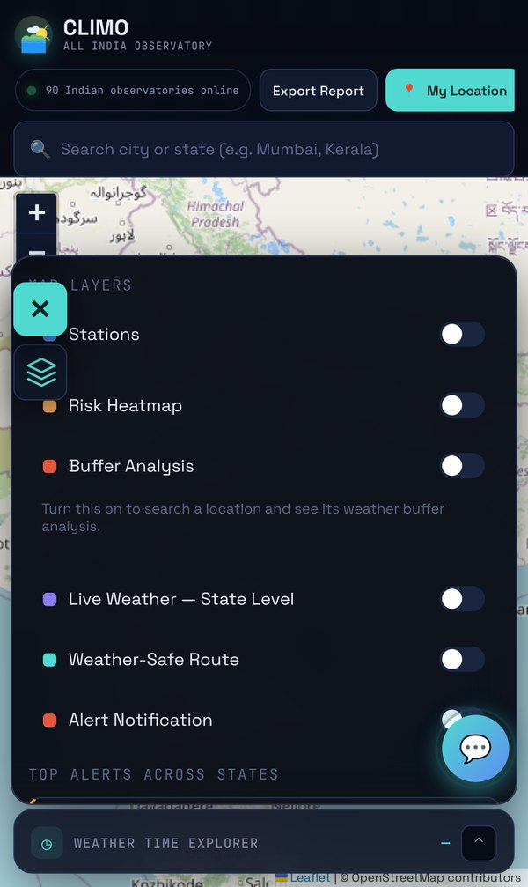

# 🧭 CLIMO User Guide

> A guided tour of every screen, layer and button. For the maths behind the numbers, see [METHODOLOGY.md](METHODOLOGY.md).

**Contents:** [Getting in](#1-getting-in) · [The dashboard at a glance](#2-the-dashboard-at-a-glance) · [Map layers](#3-map-layers) · [Station drawer](#4-the-station-drawer) · [Weather time explorer](#5-weather-time-explorer) · [Weather Buddy](#6-weather-buddy) · [Search, click and locate](#7-search-click-and-locate) · [Export](#8-export-report) · [Languages](#9-languages) · [Mobile](#10-on-mobile) · [FAQ](#11-faq)

---

## 1. Getting in

| Step | Page | What happens |
|---|---|---|
| ① | `index.html` (splash) | The animated CLIMO logo shows over a starfield. It moves on after **2.6 s**, or you can **tap anywhere** to skip. |
| ② | `CLIMO.html` (landing) | The 3D India scene tilts with your mouse. **Explore Weather** or **Explore Climo** opens the dashboard. |
| ③ | `CLIMO_backend.html` (dashboard) | A loader reads *“Fetching all India stations…”* while 90 stations load, five at a time. |

> 💡 You can bookmark `CLIMO_backend.html` to go straight to the map. Click the CLIMO logo in the top bar to return to the landing page.

---

## 2. The dashboard at a glance

<p align="center"></p>

```text
┌───────────────────────────────────────────────────────────────────────────────────┐
│ ① Brand   ② Search…                     ③ ● 90 online  ④ Export  ⑤ My Location  ⑥ 🌐 │
├──────────────┬────────────────────────────────────────────────────────────────────┤
│ ⑦ MAP LAYERS │   ⑨ Weather Time Explorer           ⑩ alert banner                   │
│  Stations    │                                                                     │
│  Risk Heatmap│                      🗺️  the map                                     │
│  Buffer      │                                                                     │
│  State level │   ⑪ basemap switch                                ⑫ legend           │
│  Safe route  │                                                                     │
│  Alerts      │                                                                     │
│ ⑧ TOP ALERTS │   ⑬ 💬 Weather Buddy                                                │
└──────────────┴────────────────────────────────────────────────────────────────────┘
```

| # | Control | Purpose |
|---|---|---|
| ① | Brand | Back to the landing page |
| ② | Search | Stations first, then any place in India |
| ③ | Live chip | How many observatories loaded. If the network is down it reads *“No internet — map only”*. |
| ④ | Export Report | Download a CSV of every station |
| ⑤ | My Location | Uses GPS to drop a “me” point and find your nearest station |
| ⑥ | Language | Switch between 16 languages |
| ⑦ | Map layers | Toggles for every analytical layer (section 3) |
| ⑧ | Top alerts | The riskiest stations right now. Click one to fly to it. |
| ⑨ | Time explorer | Scrub through hours, or through the years 2000–2030 |
| ⑩ | Alert banner | Appears when a station reaches Moderate or High risk. Tap it for details, or ✕ to dismiss. |
| ⑪ | Basemap | OpenStreetMap ⇄ Satellite |
| ⑫ | Legend | Colour scale for whichever heatmap or choropleth is active |
| ⑬ | Weather Buddy | The chat assistant |

---

## 3. Map layers

Each layer is **opt-in**. Tap its row in the sidebar to switch it on or off.

### 📡 Stations
Shows all loaded stations as clustered markers, coloured by type:

| Type | Colour | Count |
|---|---|---|
| Automatic Weather Station (AWS) | `#5B8DEF` blue | 35 |
| Rain gauge | `#4FD9D0` teal | 24 |
| River gauge | `#8B7CF6` violet | 19 |
| Weather radar | `#F2A65A` amber | 12 |

Click a marker to open its **station drawer** (section 4). The **ⓘ** button inside the drawer shows the icon legend.

### 🔥 Risk Heatmap
Turning it on shows three buttons: **🌡️ Temp**, **💧 Humidity** and **🌧️ Rainfall**. Each draws a Leaflet.heat surface from the stations' **live** readings, with rainfall shown as the 24 h total. Click the active button again to hide it. Only one parameter is shown at a time.

### ⭕ Buffer Analysis
- **Station buffers:** draws a **15 km** circle around every station whose live risk is ≥ 34, coloured by risk band. Click a circle to see the area, the risk and how many other stations fall inside it.
- **Search any location:** type a place, or tap 📍 for GPS. CLIMO draws **5, 10, 15 and 20 km** rings (deep to light orange), fetches live weather for that exact point, and lists which stations sit inside each ring.
- Tap ✕ to clear. Everything about buffers is hidden while the toggle is off.

<p align="center"></p>

### 🗺️ Live Weather: State Level
Choose **Temperature, Rainfall, Humidity or Wind** from the dropdown.
- Every state and UT is filled with its live value, from **one batched request** to the state centroids.
- Everything outside India is dimmed, so the country stands out.
- A **canvas atmosphere** animates over the map: rain streaks, wind particles, humidity haze or heat shimmer.
- Click a state for a detail panel with current conditions, feels-like temperature, min/max and wind direction.
- If the live call fails, CLIMO falls back to labelled state-level estimates so the map is never blank.

### 🧭 Weather-Safe Route
1. **Start:** type a place, tap 📍 to use GPS, or tap 📌 and then click the map.
2. **Destination:** type a place, or tap 📌 and click the map.
3. Press **🧭 Find weather-safe route**.

CLIMO draws the shortest road route in **red**, checks live rainfall every ~25 km along it and at stations within 40 km of it, then turns risky points into avoid-zones and asks for a detour. The **safe route** is drawn alongside, with a comparison card showing the difference in time and distance. If no detour exists on the road network, CLIMO tells you so and marks the hazards. Press **✕ Close route** to reset.

> Routing needs an OpenRouteService key. See the [Deployment](DEPLOYMENT.md#-openrouteservice-key) guide.

### 🔔 Alert Notification
1. Enter your mobile number (for example `+919812345678`), then tap 📍 so CLIMO knows which station is nearest to you.
2. Choose a threshold: **Moderate 34+**, **High 50+** (the default), or **Severe 66+**.
3. Press **💾 Save & Enable**. Settings are stored only in this browser.
4. Press **🔔 Allow browser alerts** to grant notification permission.
5. Press **🧪 Simulate high-risk alert** to preview the banner and message.

CLIMO re-checks “now” every **5 minutes**. When your station's score rises past the threshold, you get the banner and a system notification.

> ⚠️ **SMS runs in demo mode.** A browser cannot send texts on its own. The message is shown in the panel and logged, and real delivery needs a backend relay. See [SECURITY.md](../SECURITY.md#-sms-alerts).

---

## 4. The station drawer

<p align="center"></p>

| Section | Shows |
|---|---|
| Header | State, station type, name and station code |
| Conditions | WMO weather description and icon |
| Nearest official station | The closest other station and its distance. Tap it to draw a road route there and load its weather. |
| Hourly strip | Past hour, now, and the next 24 hours: temperature and chance of rain |
| 7-day forecast | Daily max/min, icon and precipitation probability |
| Core readings | Temperature, humidity, hourly rain and wind |
| Regional flood risk | The 0–100 score, a bar and an explanation |
| Local feedback | Post an on-the-ground update (*Waterlogging*, *Road blocked*, *Power cut*, *All clear*…) |

Opening a drawer also tells Weather Buddy which city you are looking at.

---

## 5. Weather time explorer

The panel at the top of the map has two sliders. Click **⌃** to expand it.

| Row | Range | What it drives |
|---|---|---|
| **Hourly timeline** | 48 h ago → +10 days | Every marker's risk, the top-alerts list, the drawer readings and the clock. ▶ plays it as an animation. |
| **Climate slider** | 2000 → 2030 | A year-based heatmap of temperature, humidity or rainfall from the embedded *India Climate Pulse* table. Labelled **OBSERVED** up to 2025 and **FORECAST (LSTM)** from 2026. ▶ plays it. |

<p align="center"></p>

> All hourly timestamps are pinned to **IST (+05:30)**, so “now” is correct even if your device is in another timezone.

---

## 6. Weather Buddy

Tap **💬** (bottom-left). Try:

| You type | What happens |
|---|---|
| `weather in Pune` | Geocodes the place, flies the map there, and gives the live conditions with tips |
| `will it rain near me?` | Uses GPS, reverse-geocodes your area, and answers for that point |
| `weather in Delhi in 2 hours` · `tonight` · `tomorrow` | Answers from the hourly forecast for that time |
| `highest risk locations` / `any flood risk?` | Ranks the riskiest stations |
| `nearest station` | Finds the official station closest to you |
| `help` | Lists everything it can do |

The four quick chips (*umbrella?*, *hot today?*, *go outside?*, *flood risk?*) answer about the station you last opened. Suggestions are concrete: *“☔ Take an umbrella”*, *“🧥 Wear a sweater”*, *“🥵 Stay hydrated”*, *“💨 Secure loose items”*.

> Weather Buddy is fully local and rule-based. No chat API or key is involved, so it works the same on `file://`, on GitHub Pages and in the Android app.

---

## 7. Search, click and locate

- **Search bar:** matches stations by name or state instantly, then searches India-wide places through Nominatim. Pick a result to fly there and open its drawer, or drop a red pin for a non-station place.
- **Click anywhere:** with no analytical layer active, clicking the map shows that point's live weather and address.
- **📍 My Location:** adds a “me” point, finds your nearest station and opens a drawer for your location.

---

## 8. Export report

**📄 Export Report** downloads `weather-report-YYYY-MM-DD.csv`, UTF-8 with a BOM so Excel shows symbols correctly. It contains:

`Station · State · Temp (°C) · Humidity (%) · Rain (mm) · Wind (km/h) · Flood Risk · Risk Score (/100)`, followed by a total row. Inside the Android app, the file is handed to the system downloader.

---

## 9. Languages

Click **🌐** and pick one of 16 languages: English, हिन्दी, বাংলা, मराठी, తెలుగు, தமிழ், ગુજરાતી, اردو, ಕನ್ನಡ, ଓଡ଼ିଆ, മലയാളം, ਪੰਜਾਬੀ, অসমীয়া, मैथिली, संस्कृतम्, कोंकणी.
Labels, buttons and placeholders change instantly, and your choice is saved in `localStorage` (`climoLang`).

---

## 10. On mobile

- The top bar wraps. **☰** opens the layer sidebar as a sheet, and tapping the map closes it.
- Everything else works the same, including in the **Android app** (see [DEPLOYMENT.md](DEPLOYMENT.md#-android-apk)).

<p align="center"> &nbsp; </p>

---

## 11. FAQ

<details><summary><b>Why do I see fewer than 90 stations online?</b></summary>
Open-Meteo's free tier rate-limits bursts of requests. CLIMO loads stations five at a time to stay under the limit, but some can still fail on a busy network. Reload after a minute to get them back.
</details>

<details><summary><b>Is the risk score an official IMD warning?</b></summary>
No. It is a screening index computed in your browser from model weather data. Always follow official IMD and NDMA advisories.
</details>

<details><summary><b>Does CLIMO track me?</b></summary>
No. It has no backend, accounts or analytics. GPS is used only when you press a 📍 button, and settings stay in your browser's localStorage.
</details>

<details><summary><b>Why is “click anywhere” not working?</b></summary>
It only works while no analytical layer is using map clicks. Turn off Buffer, Route, State Level, Risk Heatmap and Alerts. The Stations layer can stay on.
</details>
