<p align="center"></p>

# 📖 User guide

> A walkthrough of CLIMO. Every screenshot is from the real app.

**Contents:** [Getting in](#-getting-in) · [The dashboard](#-the-dashboard-at-a-glance) · [Stations](#-stations) · [Risk heatmap](#-risk-heatmap) · [Buffer analysis](#-buffer-analysis) · [State weather](#-live-weather--state-level) · [Safe route](#-weather-safe-route) · [Alerts](#-alert-notification) · [Time explorer](#-weather-time-explorer) · [Weather Buddy](#-weather-buddy) · [Search, location, export](#-search-my-location-export) · [Languages](#-languages) · [Mobile](#-on-mobile) · [FAQ](#-faq)

---

## 🚪 Getting in

1. Open the **[live demo](https://chakrabortysohini2005-stack.github.io/Web-Mobile-Application-CLIMO/)**. A splash screen plays for about 2.6 s (tap to skip).
2. On the landing page, hover over the 3D India map to tilt it, then click **Explore Weather →**.
3. The dashboard shows *"FETCHING ALL INDIA STATIONS…"* while it loads all 90 stations. The chip in the top bar then reads **"90 Indian observatories online"**.

 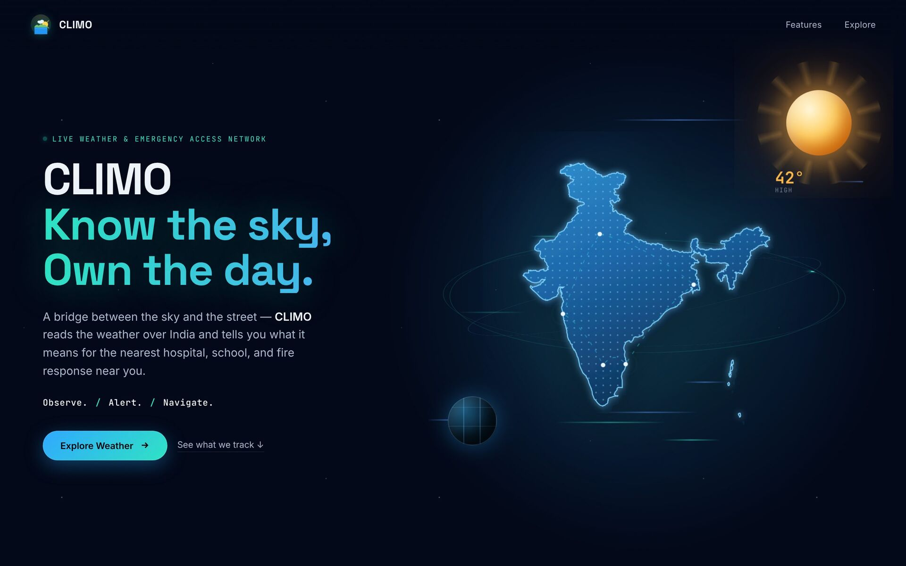

---

## 🧭 The dashboard at a glance

```
┌───────────────────────────── Top bar ─────────────────────────────────────┐
│ CLIMO logo (→ home) │ 🔍 search │ ● live count │ Export │ 📍 My Location │ 🌐 │
├──────────────┬────────────────────────────────────────────┬───────────────┤
│ MAP LAYERS   │ [+/-]  [Weather Time Explorer ▾]           │  Station      │
│  Stations    │ [≋ base maps]                              │  drawer       │
│  Risk Heatmap│                                            │  (on click)   │
│  Buffer      │                 the map                    │               │
│  State level │                                            │               │
│  Safe route  │                                            │               │
│  Alerts      │ (💬) Weather Buddy                 legend  │               │
│ TOP ALERTS   │                                            │               │
└──────────────┴────────────────────────────────────────────┴───────────────┘
```

Each sidebar row is a **toggle**. Rows that need input (heatmap, buffer, state level, route, alerts) expand when you turn them on.

---

## 🛰 Stations

Turn on **Stations** to show the 90 stations. Markers cluster when you zoom out; click a cluster to zoom in.

| Icon | Type |
|:--:|:--|
| 🔵 sun-dot | AWS (automatic weather station) |
| 🟧 triangle | Radar |
| 🟦 drop | Rain gauge |
| 🟪 wave | River gauge |

Click the **ⓘ** button in a drawer for the full legend.

**Click a station** to open its drawer:

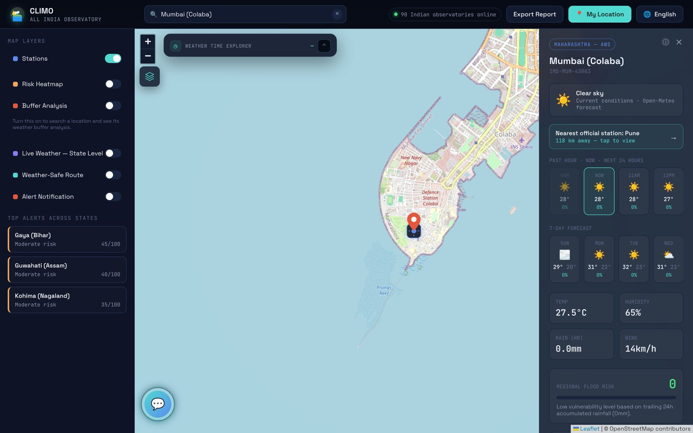

- **Current conditions**: WMO description and icon
- **Nearest official station**: click it to draw the road route there and open that station
- **Past hour · now · next 24 h** strip with rain probability
- **7-day forecast** (high/low and rain chance)
- **Temp, humidity, rain (hourly), wind** tiles
- **Regional flood risk** score (0–100) with an explanation
- **Local feedback**: post what you see (waterlogging, road blocked, power cut…)

> 💡 **Click anywhere on the map** (with no tool active) to drop a pin and get live weather for that exact spot.

---

## 🔥 Risk heatmap

Turn on **Risk Heatmap**, then choose **🌡 Temp**, **💧 Humidity** or **🌧 Rainfall**. A smooth heat field is drawn from the live readings of every station, with a legend in the bottom-right corner. Click the active button again to turn it off.

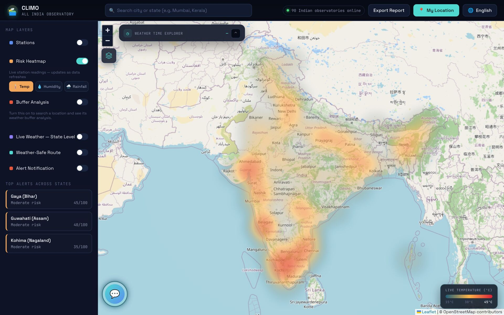

---

## 🎯 Buffer analysis

Turn on **Buffer Analysis**:

- Every station at **Moderate risk or above (≥ 34)** gets a dashed **15 km** buffer. Click it for area, the number of overlapping stations and the risk explanation.
- Use **Search Any Location** (or 📍 GPS) to draw **5 / 10 / 15 / 20 km** rings around any place. A drawer shows live conditions, a live risk score and which stations fall in each ring.

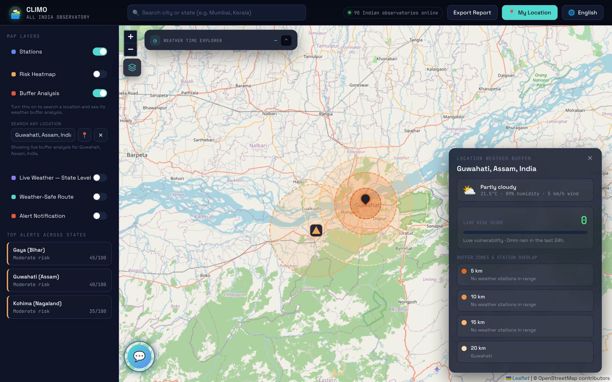

---

## 🗺 Live weather — state level

Turn on **Live Weather — State Level** and pick **Temperature, Rainfall, Humidity** or **Wind Speed**. Each state or UT is coloured by its live value, everything outside India is darkened, and an animated layer (wind streaks, rain, haze or heat shimmer) is drawn on top. Click a state for its details.

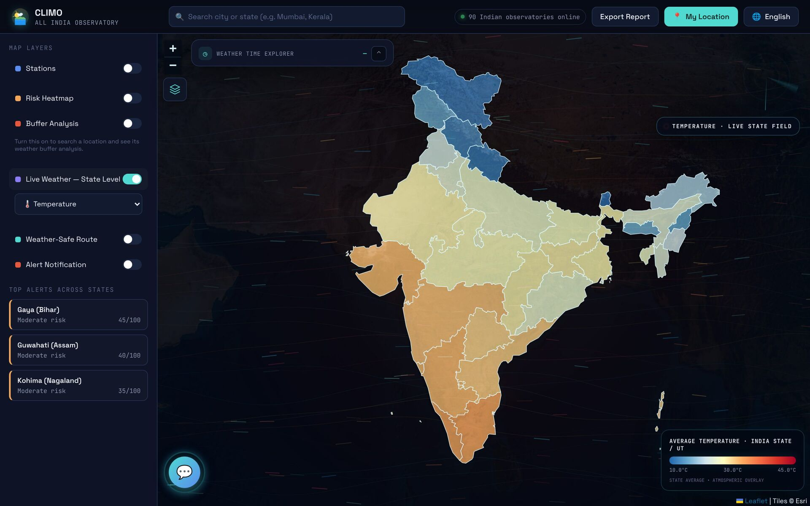

---

## 🧭 Weather-safe route

1. Turn on **Weather-Safe Route**.
2. Set the **Start** by typing a place, using 📍 GPS, or 📌 pinning it on the map.
3. Set the **Destination** by typing or 📌 pinning.
4. Click **🧭 Find weather-safe route**.

CLIMO draws the **shortest route**, checks live rainfall every 25 km along it, marks disturbances in red, and asks for a **detour** around them. Both routes are shown together with a comparison card (distance, time, number of disturbances). If the shortest route is already clear, it turns green.

> ⚙ Routing needs an [OpenRouteService](https://openrouteservice.org/dev/#/signup) key (free tier). See [DEPLOYMENT.md](DEPLOYMENT.md#-configuring-routing).

---

## 🚨 Alert notification

Turn on **Alert Notification**:

1. Enter a mobile number and press 📍 to **watch the station nearest to you**.
2. Choose a threshold: **Moderate (34+)**, **High (50+)** or **Severe (66+)**.
3. **Save & Enable**. Your settings stay in this browser.
4. **Allow browser alerts** to get native notifications.
5. **Simulate high-risk alert (demo)** to try the full flow.

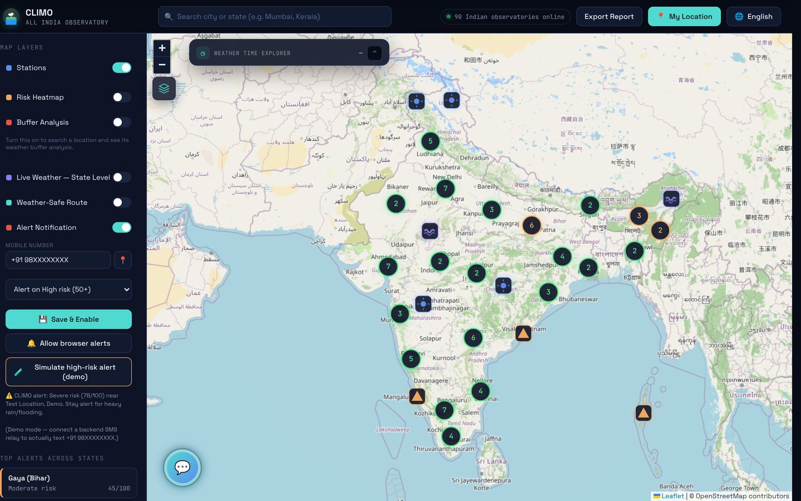

> 📨 The SMS step is **simulated**. CLIMO has no server, so the message is shown and logged instead of sent. Connect a backend relay to send real texts.

Separately from this, a **banner** slides in whenever a station crosses Moderate or High. CLIMO re-checks every 5 minutes.

---

## ⏱ Weather Time Explorer

Click **⌃** on the *Weather Time Explorer* bar to expand it.

| Row | What it does |
|:--|:--|
| **Hourly slider** (`PAST 48H · FORECAST 10D`) | scrub or ▶ play through the hours; markers and risk scores update for that hour |
| **2000–2030 climate slider** | drag through the years or ▶ play the decades. Years after 2025 are labelled **FORECAST (LSTM)** |

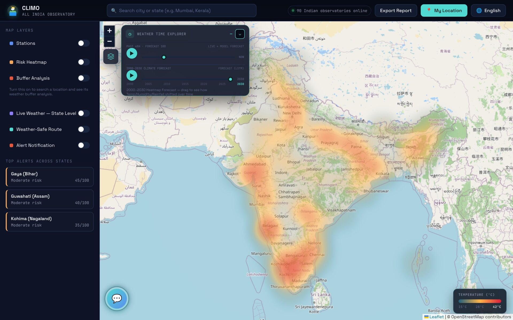

---

## 💬 Weather Buddy

Click the **💬** button (bottom-left). Try:

| You type | Buddy does |
|:--|:--|
| `weather in Pune` | live conditions for Pune with advice |
| `will it rain in Kolkata tomorrow?` | the hourly forecast for tomorrow |
| `will it rain near me in 2 hours?` | uses your GPS and the hourly forecast |
| `highest risk locations` | top 5 stations, and the map flies to #1 |
| `nearest station` | the closest station to you |
| `help` | the list of things it can do |

The chips (*Do I need an umbrella? · Is it hot today? · Should I go outside? · Any flood risk?*) are one-tap questions.

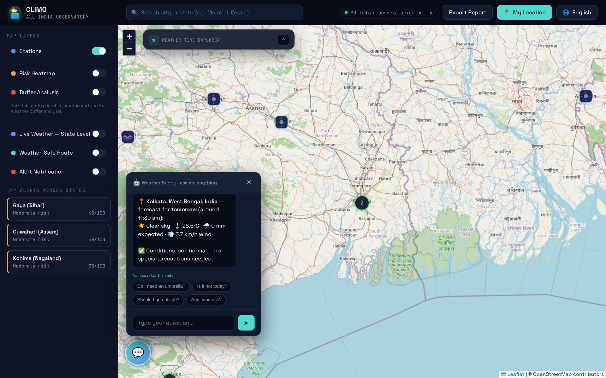

> 🧠 Buddy is **rule-based**: no AI service and no key. It matches your intent, extracts the place and time, and answers from live Open-Meteo data. Tip: add the state for ambiguous names (*"Kochi, Kerala"*).

---

## 🔍 Search, My Location, Export

- **Search** (top bar): type a station, city or state. It matches stations first, then falls back to geocoding and drops a pin.
- **📍 My Location**: uses GPS, names your neighbourhood (for example *"Model Colony, Shivajinagar, Pune"*) and opens a drawer with live weather and your nearest station.
- **Export Report**: downloads a CSV of every station's live temperature, humidity, rain, wind and risk.

---

## 🌐 Languages

Click **🌐 English** and choose from **16 languages**. The interface updates immediately and CLIMO remembers your choice.

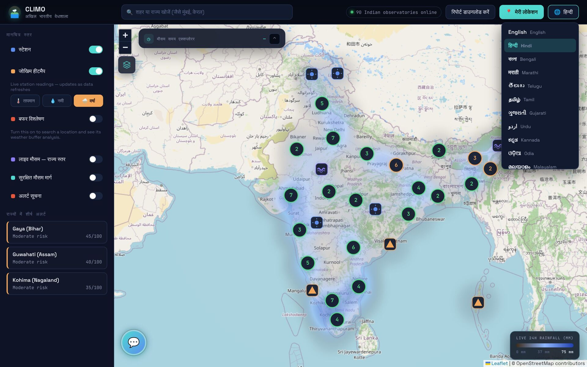

---

## 📱 On mobile

The sidebar becomes a drawer behind the **☰** button, the time explorer moves to the bottom, and the assistant goes full-width. You can also install the **Android APK** ([DEPLOYMENT.md](DEPLOYMENT.md#-android-apk)).

<p>
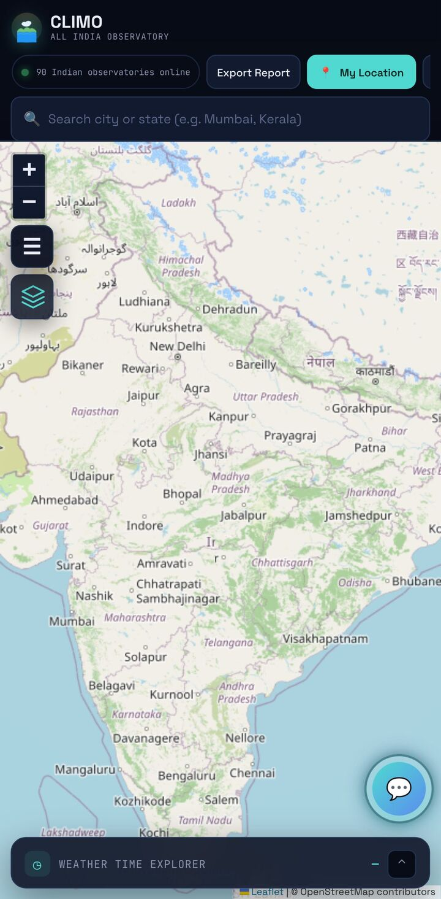
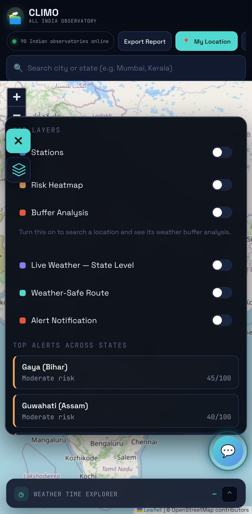
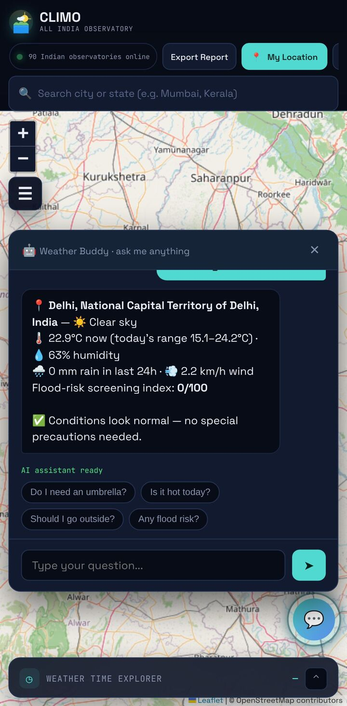
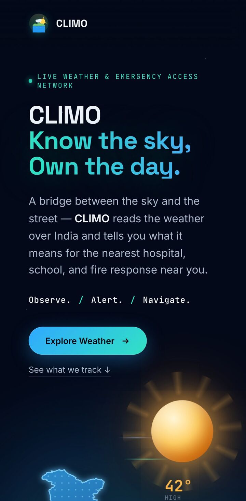
</p>

---

## ❓ FAQ

<details><summary><b>Fewer than 90 stations loaded. Why?</b></summary>

Open-Meteo's free tier rate-limits per IP (HTTP 429). CLIMO already caps itself at 5 concurrent requests. On shared networks some stations may still fail. Reload after a minute.
</details>

<details><summary><b>"My Location" or notifications don't work.</b></summary>

Browsers only allow geolocation and notifications on **secure contexts** (`https://` or `localhost`). Opening the file with `file://` blocks them. Serve it locally or use the live demo.
</details>

<details><summary><b>Routing says "network or CORS error".</b></summary>

The OpenRouteService key may be missing, over quota, or blocked by your network. Add your own key (see DEPLOYMENT.md).
</details>

<details><summary><b>Is the flood-risk score an official warning?</b></summary>

**No.** It is a weather-based screening index. For official warnings, follow IMD, NDMA and your State Disaster Management Authority. See [RISK_MODEL.md](RISK_MODEL.md).
</details>
